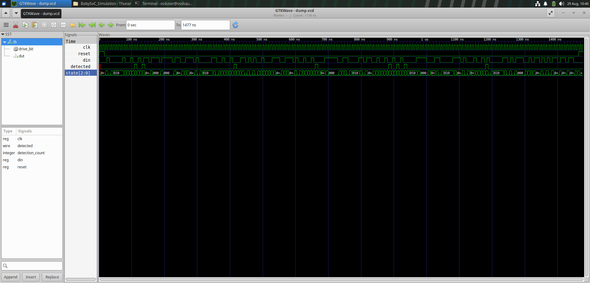
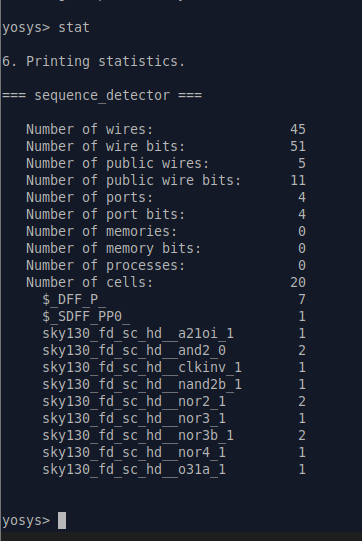
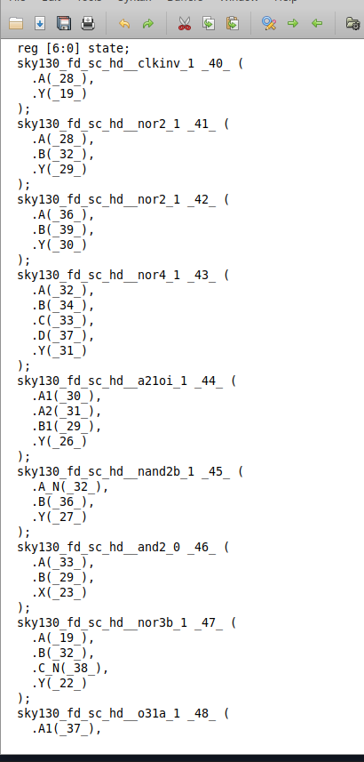
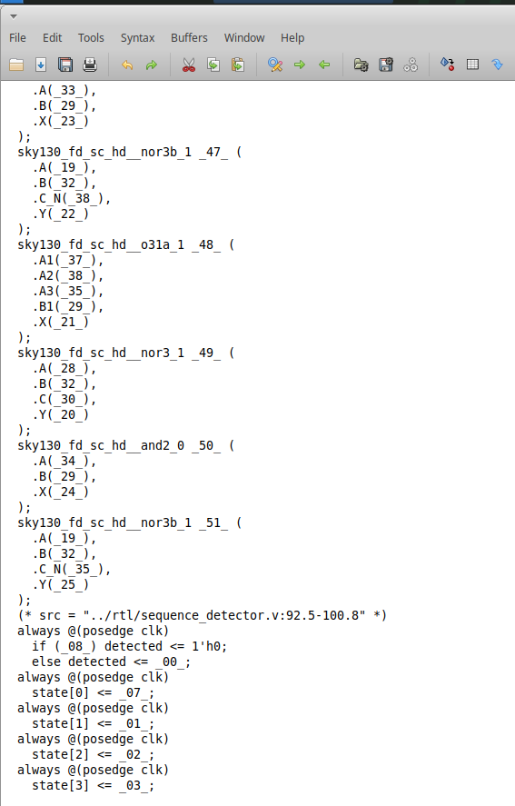
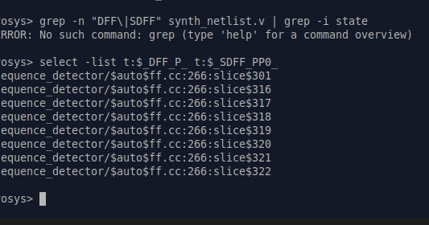
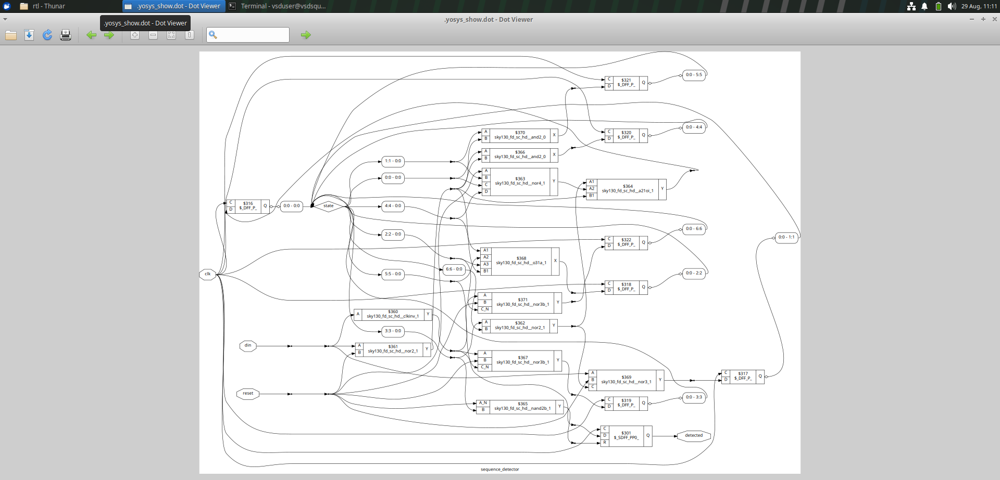
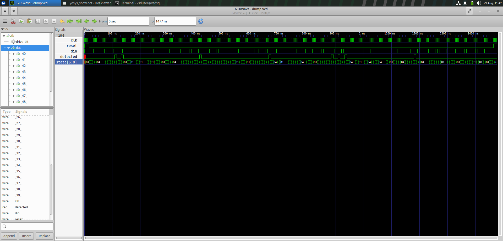
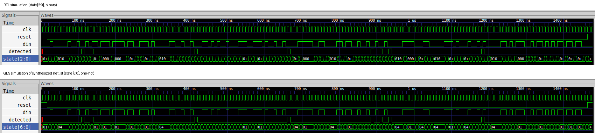
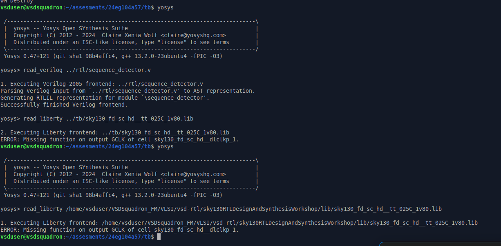

# Assignment 1 – Sequence Detector: RTL to GLS Verification

**Assessment date:** 29-08-2026

This assignment takes a 7-bit sequence detector through the full digital flow: reading and understanding the RTL, simulating it, synthesizing it with Yosys, and checking the synthesized netlist with gate-level simulation (GLS). As in the weekly notes, this is a record of what I ran and what I understood from it.

The flow:

`RTL → RTL simulation → Waveform check → Yosys synthesis → Synthesis statistics → Netlist → GLS → RTL vs GLS comparison`

Files in this folder:

- `src/sequence_detector.v` – the RTL
- `src/tb.v` – the testbench
- `src/rtl_sim_output.txt` – console output of the RTL simulation
- `images/` – waveforms, synthesis statistics, netlist and schematic screenshots

---

## 1. Target Sequence and FSM

The detector looks for this sequence in a serial bit stream:

```text
0010010
```

It is a finite state machine (FSM) whose state records how many bits of the target have been matched so far. State `s` means "the last `s` bits received match the first `s` bits of the target".

| State | Matched so far | `din = 0` goes to | `din = 1` goes to |
|---:|---|---:|---:|
| 0 | *(nothing)* | 1 | 0 |
| 1 | `0` | 2 | 0 |
| 2 | `00` | 2 | 3 |
| 3 | `001` | 4 | 0 |
| 4 | `0010` | 5 | 0 |
| 5 | `00100` | 2 | 6 |
| 6 | `001001` | **4, detected = 1** | 0 |

Detection happens in state 6: the FSM has matched `001001` and receives the final `0`.

### Why the "wrong input" arcs go where they do

A mismatch does not always send the FSM back to state 0. It goes to the longest prefix of the target that is still a suffix of what was just received. This is the same idea as the failure function in the KMP string-matching algorithm.

- **State 2 on `0` → state 2.** The received tail is `000`, and its last two bits `00` are still a valid prefix of the target.
- **State 5 on `0` → state 2.** The received tail is `001000`, and its last two bits `00` are again a valid prefix.
- **State 6 on `0` → state 4.** After a full match of `0010010`, its last four bits `0010` are already a prefix of the target. The FSM therefore restarts four bits in, which lets overlapping occurrences be detected.

---

## 2. RTL Design

The module uses the standard two-process FSM structure (full code in `src/sequence_detector.v`):

1. **Combinational block** (`always @(*)`) – computes `next_state` and `next_detected` from `state` and `din`.
2. **Sequential block** (`always @(posedge clk)`) – on each rising edge, loads `state` and `detected` with the next values, or clears them to 0 when `reset` is high.

Key points:

- **State storage:** `reg [STATE_W-1:0] state;` with `STATE_W = 3`. Seven states fit in 3 bits (2³ = 8), leaving one unused code. The `default:` branch sends that code back to state 0.
- **Output:** `detected` depends on the current state and the current input, because `next_detected` is 1 only when `state == 6` and `din == 0`. It is registered, so it changes only on a clock edge, which keeps it glitch-free.
- **Reset:** synchronous and active-high; it is only seen on a rising clock edge.
- `din` can change at any time without moving `state`. The combinational `next_state` reacts instantly, but `state` itself only updates on `posedge clk`.

---

## 3. Testbench

The testbench (`src/tb.v`) generates the clock, applies reset, drives the input stream, and counts detections.

**Clock:** `always #4 clk = ~clk;`

| Parameter | Value |
|---|---|
| Half-period | 4 ns |
| Period | 8 ns |
| Frequency | 125 MHz |

**Reset:** `reset` starts at 1 and stays asserted for **2 clock cycles**. The rising edges are at 4 ns and 12 ns, and reset is released at the next falling edge, **16 ns**.

**Driving bits:** the `drive_bit` task changes `din` on the falling edge, lets the DUT sample it on the following rising edge, waits 1 ns, then prints `din` and `detected`. Changing the input on the opposite edge keeps it stable well before the DUT samples it, which avoids driver/DUT races.

```verilog
task drive_bit(input reg b);
    begin
        @(negedge clk);
        din = b;
        @(posedge clk);
        #1;
        $display("TIME=%0t NS DIN=%b DETECTED=%b", $time, din, detected);
    end
endtask
```

**Detection counter:** a monitor on the falling edge increments `detection_count` whenever `detected` is high and reset is low. It samples on the opposite edge from the DUT update, so the value it reads is stable.

**Stimulus:** 180 bits, driven by 180 `drive_bit` calls. Bit `k` is sampled at the rising edge at **20 + 8k ns**, so bit 1 is sampled at 28 ns. After the last bit, reset is asserted again for two cycles and the simulation ends at 1477 ns.

---

## 4. RTL Simulation

Compiled and run with Icarus Verilog, with the waveform (`dump.vcd`) inspected in GTKWave.

<p align="center">
  
</p>

The waveform shows `clk`, `reset`, `din`, `detected` and `state[2:0]` over 0–1477 ns. `reset` is high only at the start and the very end.

### Detections

The simulation prints `FINAL_DETECTION_COUNT=8`. The target appears **8 times**, completing at input bits 11, 14, 49, 80, 108, 111, 114 and 145. Each window below was checked to equal `0010010`.

| # | Bits of the match | Completing bit | Sampled at (ns) | Printed by `$display` at (ns) |
|---:|---|---:|---:|---:|
| 1 | 5–11 | 11 | 108 | 109 |
| 2 | 8–14 | 14 | 132 | 133 |
| 3 | 43–49 | 49 | 412 | 413 |
| 4 | 74–80 | 80 | 660 | 661 |
| 5 | 102–108 | 108 | 884 | 885 |
| 6 | 105–111 | 111 | 908 | 909 |
| 7 | 108–114 | 114 | 932 | 933 |
| 8 | 139–145 | 145 | 1180 | 1181 |

- **First occurrence:** the target first appears at **bits 5–11** of the stream, so the first `detected = 1` is seen at about **108 ns**, in the cycle of the 11th bit.
- **Overlaps:** matches 1 and 2 share four bits (bits 8–11), and matches 5, 6 and 7 are each only three bits apart. These come from the state 6 → state 4 arc.
- **Timing of `detected`:** because `state` and `detected` update together on the same rising edge that samples the completing bit, `detected` is already 1 when `drive_bit` prints, 1 ns after that edge. It is not delayed by an extra clock cycle.
- The first `detected` pulse on the waveform appears near 108 ns, with later pulses at about 132, 412, 659, 882, 907, 930 and 1178 ns, each one clock period (8 ns) wide.

The console output is saved in `src/rtl_sim_output.txt` (times are printed in ps, so `109000` means 109 ns).

---

## 5. Synthesis with Yosys

Yosys reads the RTL, synthesizes it, and maps the combinational logic to `sky130_fd_sc_hd` standard cells. `stat` then reports what was produced.

<p align="center">
  
</p>

| Item | Count |
|---|---:|
| Wires | 45 |
| Wire bits | 51 |
| Public wires / bits | 5 / 11 |
| Ports / port bits | 4 / 4 |
| Memories, processes | 0, 0 |
| **Total cells** | **20** |

**Sequential cells: 8**

| Cell | Count |
|---|---:|
| `$_DFF_P_` | 7 |
| `$_SDFF_PP0_` | 1 |

**Combinational cells: 12**

| Cell | Count |
|---|---:|
| `sky130_fd_sc_hd__a21oi_1` | 1 |
| `sky130_fd_sc_hd__and2_0` | 2 |
| `sky130_fd_sc_hd__clkinv_1` | 1 |
| `sky130_fd_sc_hd__nand2b_1` | 1 |
| `sky130_fd_sc_hd__nor2_1` | 2 |
| `sky130_fd_sc_hd__nor3_1` | 1 |
| `sky130_fd_sc_hd__nor3b_1` | 2 |
| `sky130_fd_sc_hd__nor4_1` | 1 |
| `sky130_fd_sc_hd__o31a_1` | 1 |

The flip-flops are still generic Yosys internal cells (`$_DFF_P_`, `$_SDFF_PP0_`) rather than `sky130_fd_sc_hd__df*` cells, because flip-flop mapping to the library was not part of this run.

### State encoding: binary in the RTL, one-hot in the netlist

I wrote a 3-bit binary state register, but the synthesized netlist declares `reg [6:0] state;`. Yosys's FSM optimization passes (`fsm_extract`, `fsm_recode`, `fsm_map`) detected the state machine and re-encoded it as **one-hot**: 7 flip-flops, exactly one bit high at a time. That explains the 8 flip-flops: 7 for `state[6:0]` plus 1 for `detected`.

One-hot uses more flip-flops than binary (7 against 3) but needs simpler next-state logic. It is the usual area-against-speed trade-off.

### Synthesized netlist

The netlist lists the gates (`clkinv`, `nor2`, `nor4`, `a21oi`, `nand2b`, `and2`, `nor3b`, `o31a`, `nor3`) and the registers.

<p align="center">
  
</p>

The register section shows `detected` and each `state[n]` bit driven on `posedge clk`. Only `detected` has an `if (...) detected <= 1'h0` branch, so it is the one flop with a built-in synchronous reset. The reset for the state bits is folded into their input logic.

<p align="center">
  
</p>

### Flip-flop instance

`select -list t:$_DFF_P_ t:$_SDFF_PP0_` lists all eight flip-flop cells. Their names are auto-generated (`$auto$ff.cc:266:slice$301`, `…$316`, `…$317`, and so on) because the original signal names did not survive the FSM re-encoding.

<p align="center">
  
</p>

Selecting only `t:$_SDFF_PP0_` returns one cell, which is the `detected` register:

- **Instance name:** `sequence_detector/$auto$ff.cc:266:slice$301`
- **Cell type:** `$_SDFF_PP0_` (D flip-flop with synchronous active-high reset to 0)

### Schematic

The graphical schematic generated by Yosys/Graphviz shows the flip-flops, the gate network, the inputs (`clk`, `reset`, `din`) and the feedback paths that implement the FSM transitions.

<p align="center">
  
</p>

---

## 6. Gate-Level Simulation (GLS)

GLS runs the same testbench against the synthesized netlist instead of the RTL, to confirm that synthesis did not change the behavior. The GLS waveform:

<p align="center">
  
</p>

The `dut` instance now contains the netlist's gate instances (`_40_`, `_41_`, …) and wires, and `state` is a 7-bit signal, `state[6:0]`.

### RTL vs GLS comparison

<p align="center">
  
</p>

- **Same detections.** The `detected` pulses land at the same times in both runs, with the same clusters (two close together near 110–140 ns, three close together near 880–930 ns) and the same total of 8.
- **Same stimulus and reset behavior.** `clk`, `reset` and `din` are identical in both.
- **Different state representation.** RTL shows `state[2:0]` binary values such as `000` and `010`. GLS shows `state[6:0]` one-hot values such as `01` and `04` in hex, meaning `0000001` and `0000100`.

### Timing difference

The visible difference between the two waveforms is the **state encoding** (binary in the RTL, one-hot in the netlist). The GLS here was run without SDF back-annotation, so it is a zero-delay functional GLS and the transitions fall on the same clock edges as in RTL. A timing-annotated GLS with real cell delays would instead show `state` and `detected` changing a little after each clock edge, by the propagation delay through the gates.

---

## 7. Problems Faced and How I Addressed Them

### Liberty file error in Yosys

`read_liberty` stopped with `ERROR: Missing function on output GCLK of cell sky130_fd_sc_hd__dlclkp_1`.

<p align="center">
  
</p>

`dlclkp_1` is an integrated clock-gating cell. Its `GCLK` output is a gated clock, so the library gives it no Boolean function, and Yosys's liberty parser expects one. The fix is to tell `read_liberty` to ignore missing functions with `-ignore_miss_func` (and `-lib` to load the cells as black boxes for hierarchy resolution). The error was not a problem with the RTL.

### Reading the waveform for the first detection

It is easy to count detections by eye and be off by one or two, especially with overlapping matches. I confirmed the count by checking every completed window against `0010010` and by comparing the simulator's `FINAL_DETECTION_COUNT` and the printed `DETECTED=1` lines, instead of trusting a hand scan of 180 bits.

---

## 8. Technical Learnings

1. **An FSM is two blocks with different jobs.** The combinational block decides what the next state should be; the sequential block is the only place the state actually changes, and only on a clock edge.
2. **`din` alone does not move the state.** It changes `next_state` immediately, but `state` waits for the next rising edge.
3. **Mismatch arcs follow the longest useful prefix.** The self-loop on state 2 and the 6 → 4 arc are what make overlapping detection work.
4. **A registered output is available from the edge that produced it**, not one edge later. `detected` is 1 right after the edge that samples the completing bit.
5. **Drive inputs on the opposite clock edge from the one the DUT samples**, to avoid races between the testbench and the DUT.
6. **Synthesis may change the internals but not the behavior.** Yosys re-encoded my 3-bit binary FSM as 7-bit one-hot, and the observable output stayed the same.
7. **Binary vs one-hot is an area/speed trade-off:** 3 flip-flops with more decode logic, against 7 flip-flops with simpler next-state logic.
8. **Hand-counting a long bit stream is error-prone.** Simulation output and waveform checks are the reliable way to count overlapping matches.
9. **GLS is the check that synthesis preserved function.** Zero-delay GLS checks logic; SDF-annotated GLS also checks timing.

---

## 9. Final Inference – RTL vs GLS Functional Equivalence

I verified that the synthesized gate-level netlist preserves the functional behavior of my RTL design for this testbench. I ran both simulations — the RTL simulation with `state[2:0]` binary-encoded, and the gate-level simulation with `state[6:0]` one-hot-encoded after synthesis — and compared their `detected` waveforms directly. In both runs, I observed `detected` pulses occurring at identical simulation times across the entire test, with the same clustering pattern and the same total pulse count, even though the internal state representation was completely different due to Yosys's FSM re-encoding (`fsm_recode`) during synthesis. Since the externally observable behavior of my design — the `detected` signal's timing — was bit-for-bit and cycle-for-cycle identical between the two simulations, I'm confident this is solid evidence of RTL-to-gate functional equivalence, which is exactly the confidence check GLS is meant to give me before trusting a synthesized design to move forward toward tapeout.

The supporting screenshots are the RTL waveform (Section 4) and the GLS waveform (Section 6), shown together in the comparison figure.

**Supporting document:** [`Final_Inference_29-08-2026.docx`](./Final_Inference_29-08-2026.docx) – the submitted inference with the RTL and GLS screenshots.

---

## 10. Final Results

| Parameter | Result |
|---|---|
| Target sequence | `0010010` |
| FSM states | 7 (states 0–6) |
| State register in RTL | `state[2:0]`, binary |
| State register in netlist | `state[6:0]`, one-hot |
| Output depends on | Current state and input (registered) |
| Clock half-period / period / frequency | 4 ns / 8 ns / 125 MHz |
| Reset | Asserted at start for 2 cycles, released at 16 ns |
| Stimulus length | 180 bits |
| First occurrence | Bits 5–11 |
| First `detected = 1` | ≈ 108 ns (11th bit) |
| Total detections | 8 |
| Sequential cells | 8 (7 × `$_DFF_P_`, 1 × `$_SDFF_PP0_`) |
| Combinational cells | 12 |
| Total cells | 20 |
| `detected` flip-flop | `sequence_detector/$auto$ff.cc:266:slice$301`, `$_SDFF_PP0_` |
| GLS result | Same detection times and count as RTL |

## 11. Conclusion

The sequence detector for `0010010` was designed as a 7-state FSM, simulated, synthesized and verified with gate-level simulation. The RTL simulation shows 8 detections, the first at about 108 ns, including overlapping matches that the state 6 → state 4 arc makes possible.

Yosys synthesized the design to 20 cells: 8 flip-flops and 12 combinational gates. It re-encoded the 3-bit binary state register as a 7-bit one-hot register. The GLS waveform has the same `detected` pulses at the same times as the RTL waveform, so the synthesized netlist preserves the functional behavior of the RTL for this testbench. The only visible difference is the internal state encoding.
