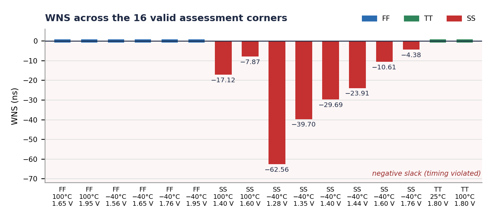
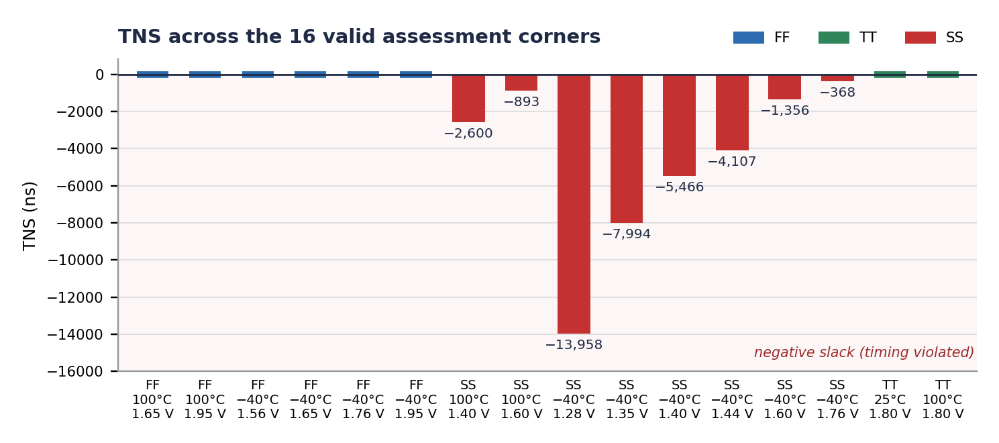
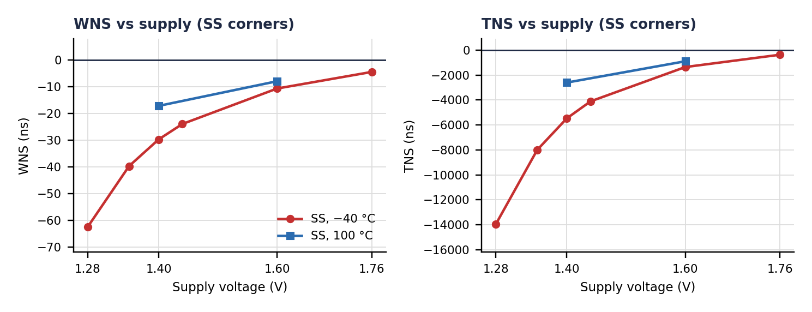
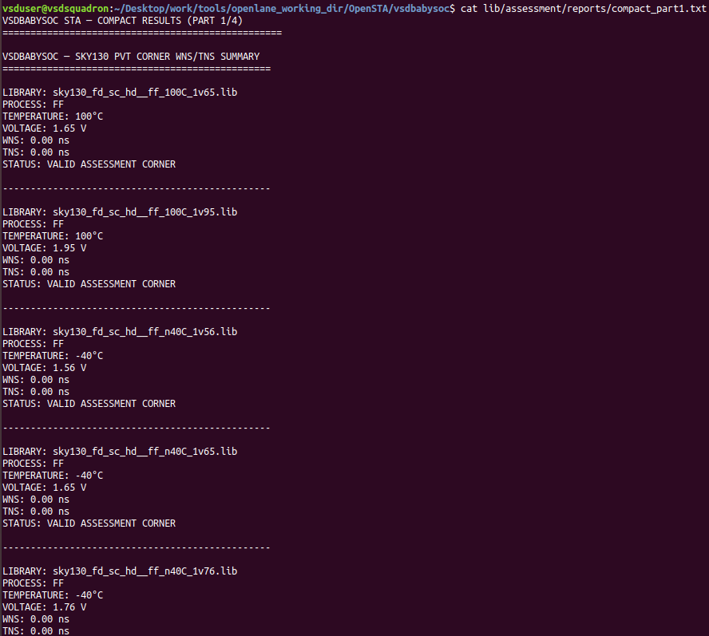
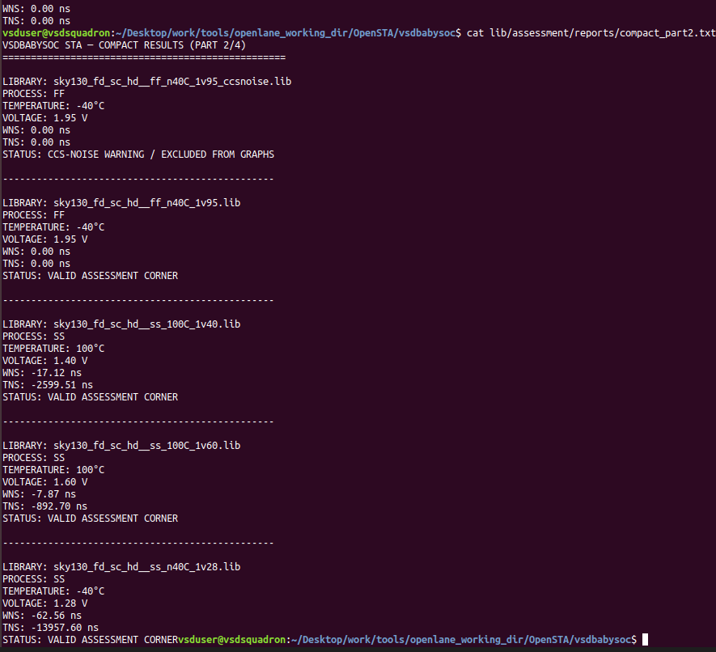
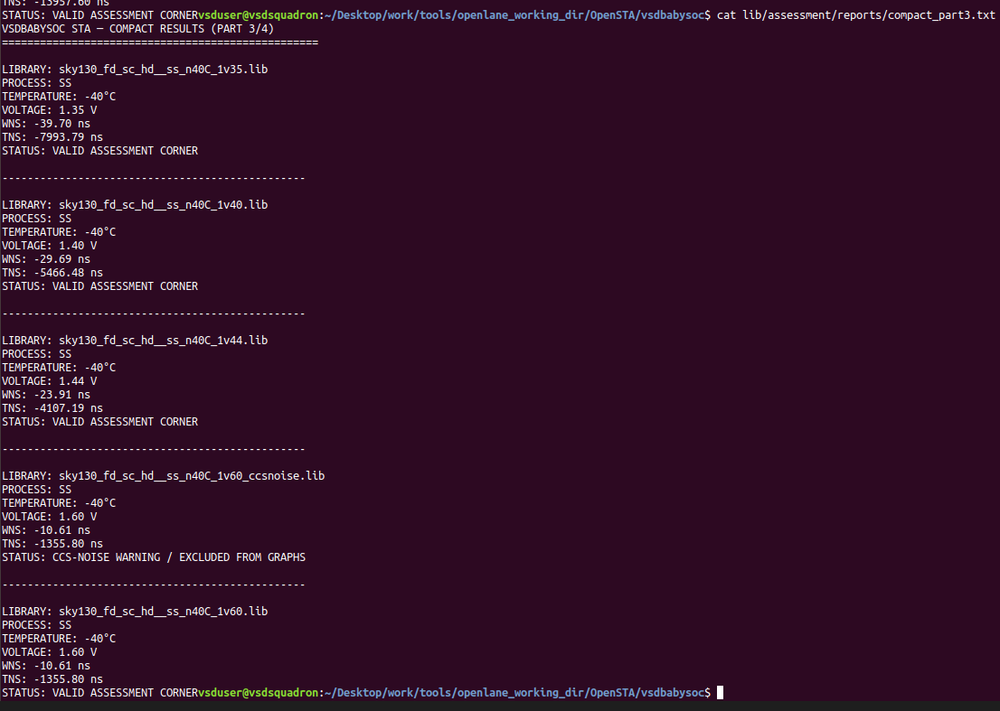
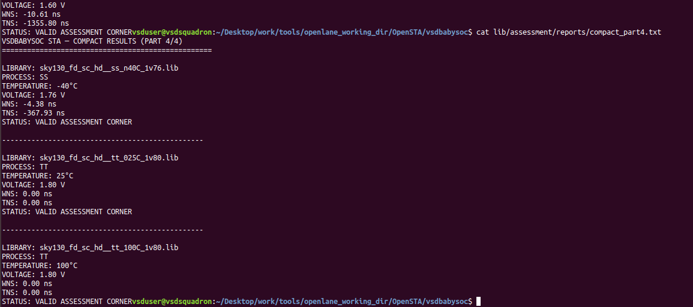
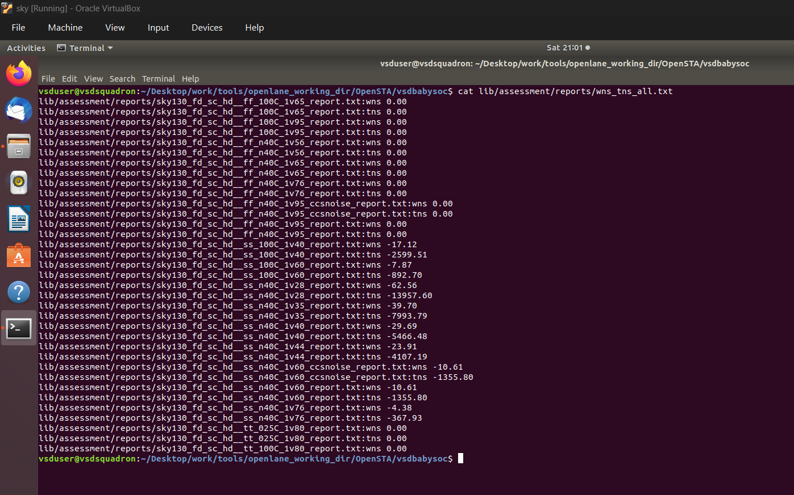
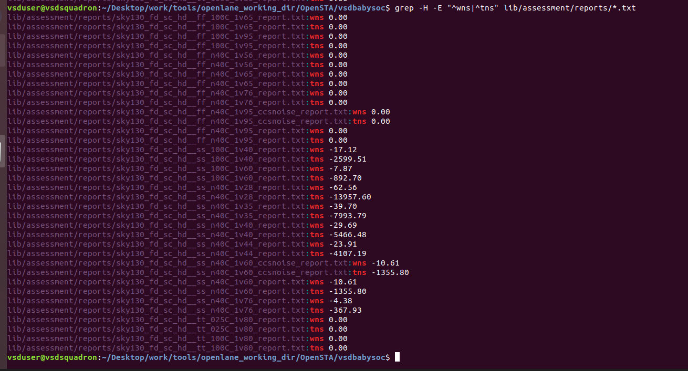

# Assignment 2 – Multi-Corner Static Timing Analysis of VSDBABYSOC (SKY130 PVT Corners)

**Assessment date:** 19-09-2026

## Objective

This assessment runs Static Timing Analysis (STA) on the VSDBABYSOC design with OpenSTA, using the provided SKY130 `sky130_fd_sc_hd` standard-cell Liberty corner libraries, to observe how timing changes with process, voltage and temperature (PVT). The point is to look at the worst-case behavior across corners instead of relying on a single typical-corner result.

**Scope:** 18 assessment Liberty corners were analyzed. The original TT 25 °C, 1.80 V library is kept as the baseline (Idx 0). Two of the 18 are CCS-noise libraries; their values stay in the results table but are left out of the plots, so the plots show 16 valid corners.

| Quantity | Result |
|---|---|
| Assessment corners analyzed | 18 (plus the TT 25 °C baseline) |
| Valid corners with no negative slack | 8 of 16 (all FF and TT) |
| Valid corners with negative slack | 8 of 16 (all SS) |
| Worst WNS | **−62.56 ns** at SS, −40 °C, 1.28 V (TNS −13,957.60 ns) |

## Contents

1. [PVT Corner Meaning](#1-pvt-corner-meaning)
2. [Slack, WNS and TNS](#2-slack-wns-and-tns)
3. [STA Methodology](#3-sta-methodology)
4. [WNS / TNS Results](#4-wns--tns-results)
5. [Comparative Plots](#5-comparative-plots)
6. [Key Observations](#6-key-observations)
7. [CCS-Noise Corner Note](#7-ccs-noise-corner-note)
8. [STA Output Evidence](#8-sta-output-evidence)
9. [Technical Learnings](#9-technical-learnings)
10. [Conclusion](#10-conclusion)

---

## 1. PVT Corner Meaning

PVT stands for Process, Voltage and Temperature. Each Liberty file models the standard cells at one such operating point, and the file name encodes it. For example, `sky130_fd_sc_hd__ss_n40C_1v28.lib` means SS process, −40 °C, 1.28 V.

| Field | Meaning | Values in this assessment |
|---|---|---|
| Process (P) | Process-speed characterization of the library | FF = Fast-Fast, TT = Typical-Typical, SS = Slow-Slow |
| Temperature | Temperature the library is characterized at | `n40C` = −40 °C, `025C` = 25 °C, `100C` = 100 °C |
| Voltage (V) | Supply voltage, encoded in the file-name suffix | `1v28` = 1.28 V, `1v65` = 1.65 V, `1v80` = 1.80 V |
| `ccsnoise` | Variant of the library with CCS-noise tables | `ff_n40C_1v95_ccsnoise`, `ss_n40C_1v60_ccsnoise` |

A chip is not manufactured at one fixed point. Real silicon varies, and the design has to meet timing across the whole range the foundry guarantees, so a typical-corner pass says little about the worst case.

---

## 2. Slack, WNS and TNS

**Slack** on a timing path is the margin between when a signal is required to arrive and when it actually arrives:

```text
Slack = Required Time − Arrival Time
```

Positive slack means the path meets timing; negative slack is a violation.

- **WNS (Worst Negative Slack)** is the single worst slack in the design. `WNS ≥ 0` means no violation was reported; `WNS < 0` means at least one path fails, and the magnitude says by how much.
- **TNS (Total Negative Slack)** is the sum of the negative slack over every violating endpoint. It measures how widespread the violations are, which WNS alone does not.

A value of `0.00 ns` means OpenSTA reported no negative slack. It does not quantify positive margin.

---

## 3. STA Methodology

Each Liberty corner was analyzed separately while the PLL and DAC libraries were kept unchanged. The same synthesized VSDBABYSOC netlist and the same SDC constraints were used for every run.

Detailed timing was reported per corner with:

```tcl
report_checks -path_delay min_max -fields {nets cap slew input_pins fanout}
```

WNS and TNS were extracted with OpenSTA's `report_wns` and `report_tns` for each corner, then collected from the per-corner report files in `lib/assessment/reports/` into summary files (Section 8).

---

## 4. WNS / TNS Results

Idx 0 is the baseline and the remaining 18 rows are the assessment corners. Idx 0 and Idx 17 are the same library (`sky130_fd_sc_hd__tt_025C_1v80.lib`), and the reports directory holds a single report for it. Idx 7 and Idx 15 are the CCS-noise corners.

| Idx | Library | P | Temp | V | WNS (ns) | TNS (ns) | Status |
|---:|---|---|---:|---:|---:|---:|---|
| 0 | `sky130_fd_sc_hd__tt_025C_1v80.lib` | TT | 25 °C | 1.80 V | 0.00 | 0.00 | Baseline |
| 1 | `sky130_fd_sc_hd__ff_100C_1v65.lib` | FF | 100 °C | 1.65 V | 0.00 | 0.00 | Assessment |
| 2 | `sky130_fd_sc_hd__ff_100C_1v95.lib` | FF | 100 °C | 1.95 V | 0.00 | 0.00 | Assessment |
| 3 | `sky130_fd_sc_hd__ff_n40C_1v56.lib` | FF | −40 °C | 1.56 V | 0.00 | 0.00 | Assessment |
| 4 | `sky130_fd_sc_hd__ff_n40C_1v65.lib` | FF | −40 °C | 1.65 V | 0.00 | 0.00 | Assessment |
| 5 | `sky130_fd_sc_hd__ff_n40C_1v76.lib` | FF | −40 °C | 1.76 V | 0.00 | 0.00 | Assessment |
| 6 | `sky130_fd_sc_hd__ff_n40C_1v95.lib` | FF | −40 °C | 1.95 V | 0.00 | 0.00 | Assessment |
| 7 | `sky130_fd_sc_hd__ff_n40C_1v95_ccsnoise.lib` | FF | −40 °C | 1.95 V | 0.00 | 0.00 | Excluded – CCS-noise |
| 8 | `sky130_fd_sc_hd__ss_100C_1v40.lib` | SS | 100 °C | 1.40 V | **−17.12** | **−2599.51** | Assessment |
| 9 | `sky130_fd_sc_hd__ss_100C_1v60.lib` | SS | 100 °C | 1.60 V | **−7.87** | **−892.70** | Assessment |
| 10 | `sky130_fd_sc_hd__ss_n40C_1v28.lib` | SS | −40 °C | 1.28 V | **−62.56** | **−13957.60** | Assessment |
| 11 | `sky130_fd_sc_hd__ss_n40C_1v35.lib` | SS | −40 °C | 1.35 V | **−39.70** | **−7993.79** | Assessment |
| 12 | `sky130_fd_sc_hd__ss_n40C_1v40.lib` | SS | −40 °C | 1.40 V | **−29.69** | **−5466.48** | Assessment |
| 13 | `sky130_fd_sc_hd__ss_n40C_1v44.lib` | SS | −40 °C | 1.44 V | **−23.91** | **−4107.19** | Assessment |
| 14 | `sky130_fd_sc_hd__ss_n40C_1v60.lib` | SS | −40 °C | 1.60 V | **−10.61** | **−1355.80** | Assessment |
| 15 | `sky130_fd_sc_hd__ss_n40C_1v60_ccsnoise.lib` | SS | −40 °C | 1.60 V | −10.61 | −1355.80 | Excluded – CCS-noise |
| 16 | `sky130_fd_sc_hd__ss_n40C_1v76.lib` | SS | −40 °C | 1.76 V | **−4.38** | **−367.93** | Assessment |
| 17 | `sky130_fd_sc_hd__tt_025C_1v80.lib` | TT | 25 °C | 1.80 V | 0.00 | 0.00 | Assessment |
| 18 | `sky130_fd_sc_hd__tt_100C_1v80.lib` | TT | 100 °C | 1.80 V | 0.00 | 0.00 | Assessment |

---

## 5. Comparative Plots

The plots use the 16 valid assessment corners (CCS-noise corners excluded). Slack is plotted in its natural sign, so negative slack extends downward from the 0 ns line, and corners with no negative slack appear as a flat marker on that line.

<p align="center">
  
</p>

<p align="center">
  
</p>

TNS bar labels are rounded to the nearest ns; the exact values are in the table above.

<p align="center">
  
</p>

The last figure shows WNS and TNS against supply voltage at the SS corners (−40 °C: 1.28–1.76 V; 100 °C: 1.40 V and 1.60 V).

---

## 6. Key Observations

1. **Only SS corners violate.** All six valid FF corners and both valid TT corners report 0.00 ns WNS and TNS. All eight valid SS corners report negative slack.
2. **Supply voltage dominates at SS, −40 °C.** WNS improves monotonically as the supply rises, from −62.56 ns at 1.28 V to −4.38 ns at 1.76 V (a 58.18 ns improvement over 0.48 V), and TNS improves from −13,957.60 ns to −367.93 ns. Even at 1.76 V this corner does not reach 0.00 ns.
3. **At SS, the cold corner is worse than the hot corner at the same supply.** At 1.40 V, WNS is −29.69 ns at −40 °C versus −17.12 ns at 100 °C; at 1.60 V it is −10.61 ns versus −7.87 ns. Slower behavior at low temperature when the supply is reduced is consistent with temperature inversion, although this assessment did not isolate the cause.
4. **Violations are widespread, not a few isolated paths.** Since |TNS| cannot exceed the number of violating endpoints times |WNS|, the ratio |TNS| / |WNS| gives a lower bound on that count: roughly 223 endpoints at SS, −40 °C, 1.28 V, falling to roughly 84 at 1.76 V (about 152 and 113 at SS, 100 °C, 1.40 V and 1.60 V).

---

## 7. CCS-Noise Corner Note

The assessment included two CCS-noise Liberty files: `sky130_fd_sc_hd__ff_n40C_1v95_ccsnoise.lib` and `sky130_fd_sc_hd__ss_n40C_1v60_ccsnoise.lib`. OpenSTA reported CCS-noise table-template warnings for these libraries. Their observed WNS and TNS values are kept in the results table, and both corners are left out of the plots so that warning-affected corners are not shown alongside the standard timing corners without qualification.

Their values match their non-CCS counterparts (FF, −40 °C, 1.95 V: 0.00 / 0.00 ns; SS, −40 °C, 1.60 V: −10.61 / −1355.80 ns), so excluding them does not change any conclusion.

---

## 8. STA Output Evidence

The per-corner results were collected into four compact summary files, `compact_part1.txt` to `compact_part4.txt`, which together cover all 18 assessment corners.

**`compact_part1.txt` – Idx 1–5 (FF corners)**

<p align="center">
  
</p>

**`compact_part2.txt` – Idx 6–10 (includes CCS-noise corner Idx 7)**

<p align="center">
  
</p>

**`compact_part3.txt` – Idx 11–15 (includes CCS-noise corner Idx 15)**

<p align="center">
  
</p>

**`compact_part4.txt` – Idx 16–18**

<p align="center">
  
</p>

The raw WNS and TNS values were then pulled directly from the individual OpenSTA report files.

**`cat lib/assessment/reports/wns_tns_all.txt`**

<p align="center">
  
</p>

**`grep -H -E "^wns|^tns" lib/assessment/reports/*.txt` – WNS/TNS for every corner report**

<p align="center">
  
</p>

---

## 9. Technical Learnings

1. **One corner is not enough.** FF and TT corners all showed 0.00 ns, which would have hidden eight failing SS corners if only a typical corner had been checked.
2. **WNS and TNS answer different questions.** WNS gives the single worst path; TNS together with WNS shows how many endpoints fail. The |TNS| / |WNS| ratio gives a lower bound of roughly 84 to 223 violating endpoints, so the violations are widespread.
3. **Low supply voltage is the dominant driver at SS.** Slack improves steadily as voltage rises, from −62.56 ns at 1.28 V to −4.38 ns at 1.76 V.
4. **Cold can be worse than hot at the same supply and process.** SS at −40 °C was worse than SS at 100 °C at both 1.40 V and 1.60 V, which fits temperature inversion, though the cause was not isolated here.
5. **A `0.00` is not a margin.** It means no negative slack was reported, not that the design has positive slack to spare.
6. **Warning-affected corners need to be flagged.** The two CCS-noise corners were reported but kept out of the plots, and the exclusion was checked not to change any conclusion.
7. **Automation makes corners comparable.** Per-corner reports collected into summary files and a WNS/TNS extraction made 18 runs easy to cross-check against each other.
8. **This analysis and the Week 4 post-route sweep are different analyses.** Here the input is the synthesized netlist with SDC constraints; Week 4 used the routed database with extracted SPEF. Their numbers are not directly comparable. See [Week 4 – VSDBABYSOC](../../Week_4_VSDBABYSOC).

---

## 10. Conclusion

STA was performed for all 18 provided assessment corners. FF and TT corners report 0.00 ns WNS and TNS, while SS corners show negative slack that grows steadily as the supply voltage drops. The most negative observed WNS and TNS in the standard assessment set is at SS, −40 °C, 1.28 V: **−62.56 ns WNS and −13,957.60 ns TNS**.

The violations are concentrated at the slow-process corners and are widespread across endpoints, and supply voltage is the dominant factor.

**Supporting document:** [`Assignment_2_Final_Report_19-09-2026.pdf`](./Assignment_2_Final_Report_19-09-2026.pdf) – the full submitted report with the same results and appendices.
