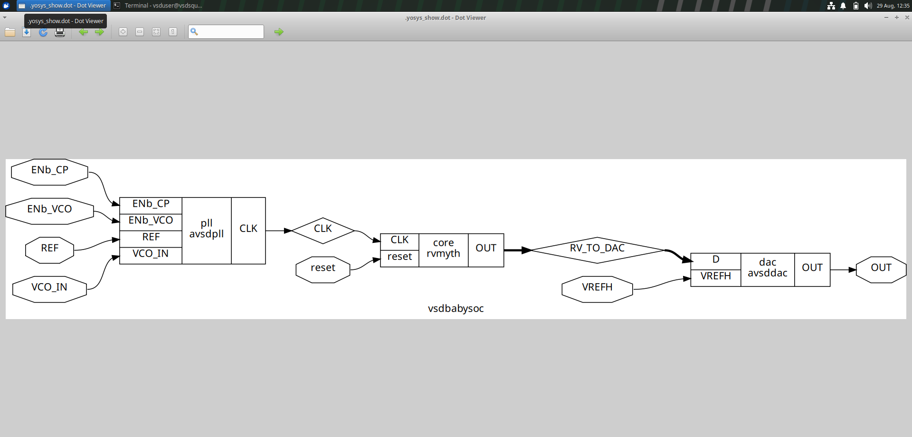
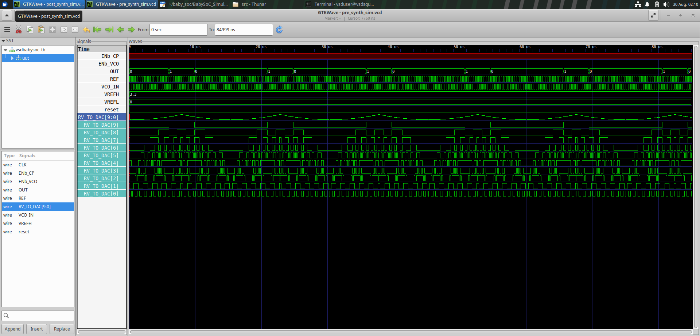
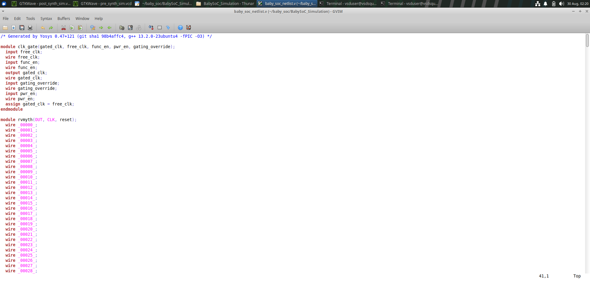
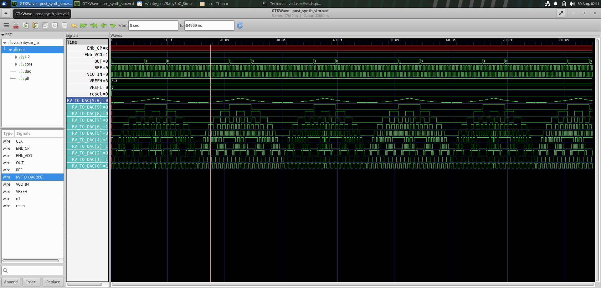
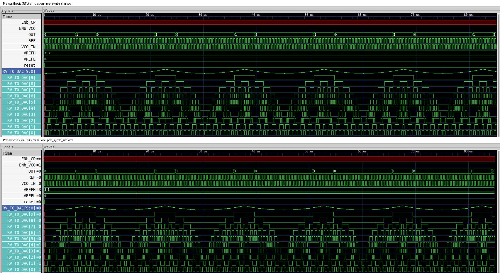

# VSDBabySoC – RTL to Post-Synthesis Gate-Level Simulation

This lab takes the BabySoC design (PLL → RVMYTH core → DAC) through the front half of the ASIC flow: pre-synthesis (RTL) simulation, logic synthesis with Yosys, and gate-level simulation (GLS) of the resulting netlist. The goal is to see the same design at two levels of abstraction and confirm that synthesis did not change its behavior.

`RTL → Pre-synthesis simulation → Yosys synthesis → Gate-level netlist → Post-synthesis simulation → RTL vs GLS comparison`

## Contents

1. [Design Overview](#1-design-overview)
2. [Pre-Synthesis Simulation](#2-pre-synthesis-simulation)
3. [Synthesis with Yosys](#3-synthesis-with-yosys)
4. [Synthesized Netlist](#4-synthesized-netlist)
5. [Post-Synthesis Simulation (GLS)](#5-post-synthesis-simulation-gls)
6. [RTL vs GLS Comparison](#6-rtl-vs-gls-comparison)
7. [Functional GLS vs Timing GLS](#7-functional-gls-vs-timing-gls)
8. [Tools Used](#8-tools-used)
9. [Technical Learnings](#9-technical-learnings)
10. [What Comes Next](#10-what-comes-next)

---

## 1. Design Overview

BabySoC is a small mixed-signal SoC built from three blocks instantiated inside the top module `vsdbabysoc`:

| Block | Instance | Role |
|---|---|---|
| **AVSDPLL** | `pll` | On-chip PLL that generates the clock for the processor |
| **RVMYTH** | `core` | RISC-V based processor core, the digital block of the SoC |
| **AVSDDAC** | `dac` | DAC that turns the processor's 10-bit digital output into an analog output |

The signal flow is **PLL → processor → DAC**:

```text
REF, VCO_IN, ENb_CP, ENb_VCO ──► AVSDPLL ──► CLK ──┐
                                                    ▼
                                          reset ──► RVMYTH ──► RV_TO_DAC[9:0]
                                                                     │
                                                                     ▼
                                                  VREFH ──────► AVSDDAC ──► OUT
```

The processor drives the 10-bit bus `RV_TO_DAC[9:0]` straight into the DAC. That bus, together with `OUT`, is the main thing tracked in both simulations, because it is the clearest evidence that the digital logic behaves the same before and after synthesis.

The Yosys block diagram of `vsdbabysoc` shows this structure directly: `pll (avsdpll)` produces `CLK`, `core (rvmyth)` takes `CLK` and `reset` and produces `RV_TO_DAC`, and `dac (avsddac)` takes `RV_TO_DAC` and `VREFH` and produces `OUT`.

<p align="center">
  
</p>

The RTL sources are `vsdbabysoc.v` (top), `rvmyth.v` (core) and `clk_gate.v`, plus the PLL and DAC models. The testbench is `vsdbabysoc_tb`, which instantiates the design as `uut`.

---

## 2. Pre-Synthesis Simulation

Before synthesis, the RTL is simulated to confirm it behaves as intended. This uses the same Icarus Verilog → GTKWave flow as the earlier labs, and writes `pre_synth_sim.vcd`.

```bash
iverilog -o pre_synth_sim.out -DPRE_SYNTH_SIM <testbench> -I <include dirs>
vvp pre_synth_sim.out
gtkwave pre_synth_sim.vcd
```

The waveform covers 0 to about 85 µs (the viewer range ends at 84999 ns). The signals tracked are `ENb_CP`, `ENb_VCO`, `OUT`, `REF`, `VCO_IN`, `VREFH`, `VREFL`, `reset` and `RV_TO_DAC[9:0]`.

<p align="center">
  
</p>

What the waveform shows:

- **`VREFH = 3.3` and `VREFL = 0`.** These are the DAC reference levels, held constant for the whole run.
- **`reset`** is asserted only at the very start, then released.
- **`REF` and `VCO_IN`** toggle continuously and densely; they are the PLL's reference and feedback inputs.
- **`RV_TO_DAC[9:0]`** shown as one bus (the blue-highlighted row) is a repeating up-and-down ramp. It peaks at roughly 8, 23, 38, 53, 68 and 83 µs, so the pattern repeats about every 15 µs.
- **The individual bits** show why it ramps: `RV_TO_DAC[9]` changes slowly, and each lower bit toggles faster, down to `RV_TO_DAC[0]`, which toggles fastest. A counting pattern in binary looks like this when the bus is drawn as an analog level.
- **`OUT`** switches between 0 and 1 in step with that ramp, with a short high pulse once per ramp period.
- **`ENb_CP`** appears red, meaning its value is unknown (x), through the whole run.

---

## 3. Synthesis with Yosys

The RTL is synthesized with Yosys against the SKY130 high-density standard-cell library:

```text
Library : sky130_fd_sc_hd
Liberty : sky130_fd_sc_hd__tt_025C_1v80.lib
```

The commands in the synthesis flow, and what each one does:

| Command | Purpose |
|---|---|
| `read_verilog` | Loads the RTL source files |
| `read_liberty` | Loads the standard-cell library so Yosys knows the available cells |
| `synth -top vsdbabysoc` | Runs the generic synthesis passes, including FSM and logic optimization |
| `dfflibmap` | Maps generic flip-flops to real library flip-flop cells |
| `opt` | Removes redundant logic and propagates constants |
| `abc` | Technology-maps the combinational logic onto SKY130 cells |
| `flatten` | Collapses the module hierarchy into a single netlist |
| `setundef -zero` | Resolves undefined signals to logic 0 |
| `clean -purge` | Removes unused and dangling logic |
| `rename -enumerate` | Gives internal signals systematic generated names |
| `write_verilog` | Writes out the gate-level netlist |
| `show` | Renders a schematic view of the design or a module |

Two of these are easy to confuse. `dfflibmap` handles the **sequential** side (flip-flops), while `abc` handles the **combinational** side (gates). Together they turn abstract RTL into real library cells.

---

## 4. Synthesized Netlist

After synthesis, the design is a netlist of SKY130 standard cells instead of behavioral RTL. The netlist file starts with the tool banner `Generated by Yosys 0.47+121 (git sha1 98b4affc4, g++ 13.2.0-23ubuntu4 -fPIC -O3)`.

<p align="center">
  
</p>

What the first part of the file shows:

- **`module clk_gate(gated_clk, free_clk, func_en, pwr_en, gating_override)`** has been reduced by synthesis to a single line, `assign gated_clk = free_clk;`. The three control inputs (`func_en`, `pwr_en`, `gating_override`) are declared but no longer influence the output in this netlist.
- **`module rvmyth(OUT, CLK, reset)`** follows, with a long list of wires named `_00000_`, `_00001_`, `_00002_` and so on. These generated names come from `rename -enumerate`, and they are the internal nets between the mapped cells.

The synthesized core is made of real SKY130 cells (NAND/NOR/AND/OR/XOR/MUX gates and flip-flops) rather than behavioral statements. This is the level that placement and routing later work on.

---

## 5. Post-Synthesis Simulation (GLS)

The synthesized netlist is simulated with the **same testbench** as the RTL run. The difference is that the simulator now needs the SKY130 Verilog cell models, because the netlist is made of library cells instead of behavioral code. The run writes `post_synth_sim.vcd`.

```bash
iverilog -o post_synth_sim.out -DPOST_SYNTH_SIM -DFUNCTIONAL -DUNIT_DELAY=#1 <testbench> <netlist> <sky130 cell models>
vvp post_synth_sim.out
gtkwave post_synth_sim.vcd
```

<p align="center">
  
</p>

Compared with the RTL run:

- **The hierarchy looks different.** The pre-synthesis `uut` is the RTL design. In the post-synthesis waveform, `uut` expands into `U2`, `core`, `dac` and `pll`, and an extra internal wire `n1` appears in the signal list. These come from the netlist.
- **The signals and the time window are the same:** `OUT`, `REF`, `VCO_IN`, `VREFH`, `VREFL`, `reset` and `RV_TO_DAC[9:0]` over the same 0 to about 85 µs.
- **The ramp on `RV_TO_DAC[9:0]` and the pulses on `OUT` repeat with the same period.**
- `ENb_CP` is again shown as x.

---

## 6. RTL vs GLS Comparison

The two waveforms, stacked with the same time axis:

<p align="center">
  
</p>

- **`RV_TO_DAC[9:0]`** follows the same ramp, peaking at the same times, in both runs.
- **The individual bits** `RV_TO_DAC[9]` down to `RV_TO_DAC[0]` show the same toggling patterns.
- **`OUT`** has its high pulses at the same places in both runs.
- **`ENb_CP`** is x in both, so both runs agree on it, and it does not affect the comparison of `RV_TO_DAC` and `OUT`.

The synthesized netlist reproduces the digital sequence the RTL produced on `RV_TO_DAC`, and the same behavior at the DAC output `OUT`. For this testbench, synthesis preserved the design's function.

---

## 7. Functional GLS vs Timing GLS

It is worth being precise about what kind of GLS this is:

- **Functional GLS** (what was run here) checks logical correctness using the standard cells' functional models. With `-DFUNCTIONAL` and a nominal `-DUNIT_DELAY`, it does not model real cell or wire delays.
- **Timing GLS** additionally annotates real cell and interconnect delays (for example with SDF), so it can expose setup and hold problems.

Matching waveforms here show the logic is right. They do not show that the design meets timing. That check is Static Timing Analysis, which is the next stage.

---

## 8. Tools Used

- **Verilog HDL** – RTL description
- **Icarus Verilog** – RTL and gate-level simulation
- **GTKWave** – waveform viewing
- **Yosys + ABC** – synthesis and technology mapping
- **SKY130 (`sky130_fd_sc_hd`)** – standard-cell library
- **Linux** – development environment

---

## 9. Technical Learnings

1. **A small SoC has real hierarchy.** Signals crossing between a PLL, a CPU and a DAC are tracked at the block boundaries, not inside one flat module.
2. **`RV_TO_DAC[9:0]` is the key evidence signal.** A binary counting pattern on a 10-bit bus looks like a ramp when drawn as an analog level, and its bits toggle at different rates, with the MSB slowest.
3. **Synthesis does different jobs in different steps.** `dfflibmap` maps flip-flops and `abc` maps gates; seeing generated names like `_00000_` in the netlist makes that concrete.
4. **Synthesis can remove structure.** `clk_gate` became a plain wire, so logic that looks important in the RTL may not survive.
5. **GLS reuses the same testbench.** The only change is that the simulator needs the library cell models, because the netlist is made of cells.
6. **The post-synthesis hierarchy is not the RTL hierarchy.** Instance names (`U2`, `core`, `dac`, `pll`) and extra wires such as `n1` come from the netlist.
7. **Matching waveforms are the evidence, not an assumption.** Comparing `RV_TO_DAC` and `OUT` before and after synthesis is what shows synthesis kept the behavior.
8. **Unknown values should be noted, not ignored.** `ENb_CP` stays x in both runs, so it does not break the comparison, but it is worth recording.
9. **Functional GLS is necessary but not sufficient.** Timing closure comes from STA.

---

## 10. What Comes Next

The next stage is Static Timing Analysis and then the physical-design flow:

`Static Timing Analysis → Floorplan → Placement → CTS → Routing → Physical verification → GDSII`

These follow-ups are documented in the same repository:

- [Assignment 2 – Multi-corner STA of VSDBABYSOC](../Assignments/Assignment_2_Multi_Corner_STA)
- [Week 4 – VSDBABYSOC RTL-to-layout flow and post-route STA](../Week_4_VSDBABYSOC)
