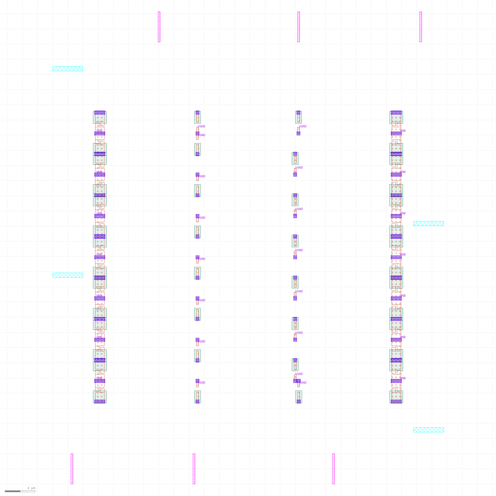
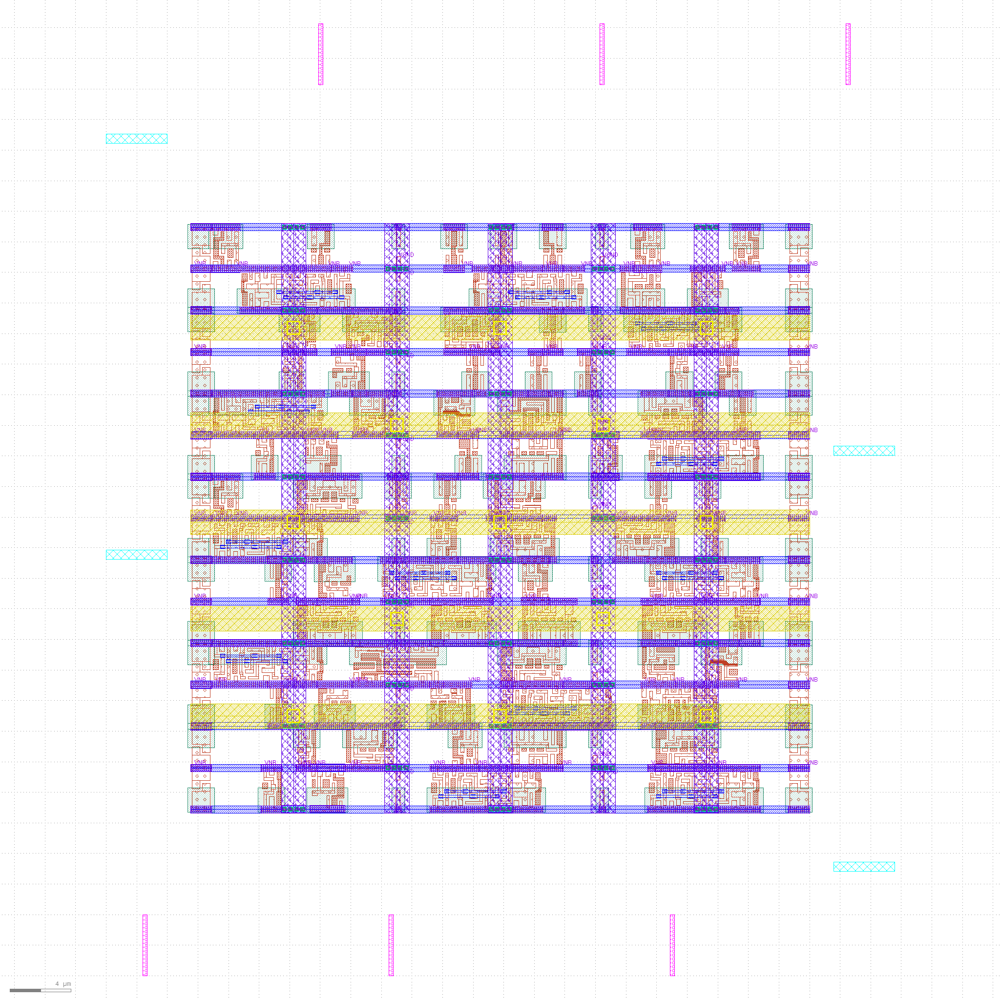
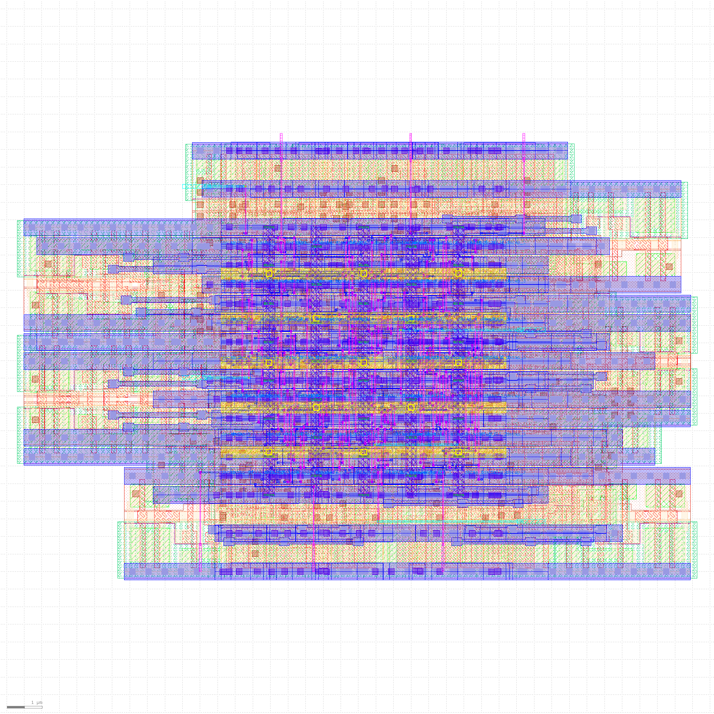

# Project — 2-of-3 Escrow Release Controller with Timeout-Based Refund

**Student:** MOLUGU DHEEKSHITH  
**Roll Number:** 24EG104A57  
**Target flow:** OpenLane · SKY130 HD  
**Configured clock:** 10 ns (100 MHz target)  
**Status:** RTL simulation passed; physical-design run completed; limitations are documented below.

> **Demo video:** Google Drive link will be added after recording and upload.

## Abstract

This project implements a synchronous Verilog controller for a simplified digital escrow decision. It records approvals from a buyer, seller, and arbiter. Two or more approvals authorize the seller-release output. If the required majority is not reached before the configured timeout, the controller authorizes a buyer-refund output. The design is an educational control-logic demonstration; it does not move money, connect to a payment network, or implement a complete financial escrow service.

The work covers RTL design, testbench-based functional simulation, synthesis, and an OpenLane physical-design run using the SKY130 HD standard-cell library. The repository separates the RTL and functional-verification material from physical-design outputs and reports so that the design source, verification evidence, implementation evidence, and limitations can be reviewed independently.

## Repository map

| Folder | Contents |
|---|---|
| [`01_RTL_Design_and_Verification/`](./01_RTL_Design_and_Verification/) | Synthesizable RTL, testbench, simulation script/log, architecture notes and synthesis statistics |
| [`02_Physical_Design_and_Reports/`](./02_Physical_Design_and_Reports/) | OpenLane configuration, synthesized netlist, GDS/layout views, floorplan/placement/CTS/routing evidence, timing/DRC/LVS/antenna reports and routed artifacts |

## Quick start: RTL simulation

Requirements: Linux or a compatible development environment with Icarus Verilog installed.

From the project root, run:

```bash
cd 01_RTL_Design_and_Verification
chmod +x sim.sh
./sim.sh
```

The testbench checks reset behavior, release after two-of-three approvals, timeout-based refund, approval priority at the timeout boundary, and reset cancellation of an active transaction. The archived run reports **ALL TESTS PASSED** for those scenarios; this is not a formal proof of all possible input sequences.

## Results at a glance

### Floorplan



### Placement



### Final layout visualization



These images are visual evidence from the recorded implementation run. They complement, but do not replace, the underlying GDSII file and physical-verification reports.

## 1. Problem statement

A transaction is held while approval signals are collected. The controller must produce exactly one terminal decision:

- **Release:** at least two of the three approvals have been received during the active transaction.
- **Refund:** the timeout expires before the required majority is available.

The approval decision takes priority if the second approval and timeout boundary coincide on a clock edge. Reset is synchronous and active-high.

## 2. RTL interface

### Inputs

| Signal | Width | Meaning |
|---|---:|---|
| `clk` | 1 | System clock |
| `rst` | 1 | Synchronous active-high reset |
| `start` | 1 | Starts or restarts a transaction |
| `buyer_approve` | 1 | Buyer approval input |
| `seller_approve` | 1 | Seller approval input |
| `arbiter_approve` | 1 | Arbiter approval input |

### Outputs

| Signal | Width | Meaning |
|---|---:|---|
| `release_to_seller` | 1 | Asserted in the RELEASED state |
| `refund_to_buyer` | 1 | Asserted in the REFUNDED state |
| `busy` | 1 | Asserted while in HOLDING |
| `done` | 1 | Asserted in either terminal state |

## 3. Controller architecture

The finite-state machine has four states:

1. **IDLE** — waits for `start`.
2. **HOLDING** — retains approvals and increments the timeout counter.
3. **RELEASED** — terminal release authorization.
4. **REFUNDED** — terminal refund authorization.

The majority function is:

`majority = (B & S) | (B & A) | (S & A)`

where `B`, `S`, and `A` are the retained buyer, seller, and arbiter approvals. Approvals are sticky during HOLDING. The default RTL parameter is `TIMEOUT_CYCLES = 16`; the testbench uses a shorter timeout so timeout scenarios run quickly.

## 4. Functional verification

The archived simulation log records these passing checks:

- Reset behavior.
- Release after two-of-three approvals.
- Timeout-based refund.
- Approval priority at the timeout boundary.
- Reset cancellation of an active transaction.

Recorded outcome: **ALL TESTS PASSED**. This result applies to the listed RTL testbench scenarios; it is not a formal proof of every possible input sequence.

## 5. Synthesis and physical implementation

The design was processed with OpenLane using the SKY130 HD standard-cell library. The evidence folder contains stage visualizations and the available implementation reports. Selected recorded results are:

| Metric | Recorded result | Evidence interpretation |
|---|---:|---|
| Yosys standard-cell count | 67 | Synthesis statistic |
| Die area | 0.003162 mm² | Value recorded in the project summary |
| Routed wire length | 1804 flow-reported units (µm in the routing summary) | Flow routing report |
| Vias | 535 | Detailed-routing report |
| Final TritonRoute violations | 0 | Final reported routing violation count |
| Magic DRC | COUNT: 0 | Recorded Magic DRC report |
| LVS | Netlists match uniquely | 87 devices and 87 nets in each circuit |
| Antenna | 0 violated pins; 0 violated nets | Antenna report |

The reported metrics are reproduced from the run evidence. They should not be interpreted as a claim of foundry sign-off or exhaustive verification.

### Timing evidence

The available OpenLane reports include post-CTS setup slack of +4.85 ns and FastRoute setup slack of +4.69 ns. The OpenLane summary also records WNS/TNS as 0.00; these are reported summary values, not the worst positive slack values. A separate supplementary STA log reports +6.72 ns worst setup slack and +0.47 ns worst hold slack under its own analysis setup. These supplementary numbers are not presented as official OpenLane sign-off metrics because identical analysis configuration has not been established.

## 6. Evidence guide

### RTL and simulation

- [`escrow_release_controller.v`](./01_RTL_Design_and_Verification/escrow_release_controller.v) — synthesizable FSM RTL.
- [`tb_escrow_release_controller.v`](./01_RTL_Design_and_Verification/tb_escrow_release_controller.v) — functional testbench.
- [`rtl_simulation.log`](./01_RTL_Design_and_Verification/rtl_simulation.log) — recorded simulation output.
- [`synthesis_statistics.rpt`](./01_RTL_Design_and_Verification/synthesis_statistics.rpt) — Yosys cell statistics.

### Physical design

- [Floorplan](./02_Physical_Design_and_Reports/04_floorplan.png) — floorplan-stage view.
- [Placement](./02_Physical_Design_and_Reports/05_placement.png) — placement-stage view.
- [Clock-tree synthesis](./02_Physical_Design_and_Reports/06_cts.png) — CTS-stage view.
- [Routing](./02_Physical_Design_and_Reports/08_routing.png) — routing-stage view.
- [GDS visualization](./02_Physical_Design_and_Reports/09_gds_visualization.png) and [Magic layout visualization](./02_Physical_Design_and_Reports/10_magic_layout_visualization.png) — generated layout visualizations.
- [Initial layout screenshot](./02_Physical_Design_and_Reports/06_initial_layout_view.png) and [final layout screenshot](./02_Physical_Design_and_Reports/07_final_layout_view.png) — captured layout-view screenshots.
- `routing_completion.log`, `magic_drc_report.txt`, `antenna_report.rpt`, and `implementation_artifacts/logs/lvs/38-lvs.lef.log` — physical-verification evidence.
- `implementation_artifacts/results/routing/` — routed DEF and SPEF artifacts where included.
- `implementation_artifacts/results/magic/` and `.../klayout/` — GDS stream outputs.

## 7. Hurdles faced and lessons learned

1. **Tool/environment setup:** Physical-design work required using a configured Linux/EDA environment and confirming that the expected tools, libraries, and paths were available.
2. **Understanding stage-specific outputs:** OpenLane creates many logs, reports, intermediate databases, and generated files. Identifying the correct report for each stage was necessary to avoid confusing synthesis, placement, CTS, routing, and final-layout evidence.
3. **RTL verification and timeout corner cases:** The testbench needed to cover normal approval, timeout refund, reset behavior, and the simultaneous approval/timeout boundary where approval has priority.
4. **Separating simulation from implementation evidence:** Passing RTL simulation establishes the tested functional scenarios, not physical correctness. Synthesis, routing, DRC, LVS, antenna, and timing reports answer different questions and must be interpreted separately.
5. **Layout inspection:** A GDS file and a screenshot of a layout viewer serve different purposes. The GDS is the layout stream artifact; screenshots help a reviewer visually inspect the result but do not replace the stream file or physical-verification reports.
6. **Timing-report interpretation:** Summary WNS/TNS values should not be mistaken for worst positive slack. The supplementary manual STA result uses a separate setup and is therefore labelled supplementary rather than official OpenLane sign-off.
7. **Gate-level simulation issue:** Gate-level simulation was attempted but remains unverified because the available standard-cell model setup did not produce a confirmed, valid gate-level result. It is not reported as a pass.
8. **Verification coverage limits:** The available evidence does not establish exhaustive process-voltage-temperature (PVT) corner coverage. This limitation is stated explicitly rather than implying full sign-off.
9. **Submission organization:** Screenshots, logs, source, configuration, and reports were grouped by purpose to make the repository navigable and to make reported claims traceable to evidence.

## 8. Limitations and scope

- This is a digital authorization controller, not a financial platform or payment processor.
- RTL simulation passed for the scenarios listed in the testbench; untested sequences may still exist.
- Gate-level simulation remains unverified.
- Exhaustive PVT-corner coverage has not been established from the available reports.
- Supplementary STA values are not claimed as official OpenLane sign-off metrics.
- The report reflects the included run and evidence files; it does not claim foundry certification.

## 9. Tools and technologies

- Verilog HDL
- Icarus Verilog (RTL simulation)
- Yosys (synthesis statistics)
- OpenLane physical-design flow
- SKY130 HD standard-cell library
- Magic / KLayout layout inspection outputs
- OpenSTA timing reports

## 10. Project details

- **Student:** MOLUGU DHEEKSHITH
- **Roll number:** 24EG104A57
- **Guide:** To be added after confirmation
- **Demonstration video:** To be added after recording and upload.

## Conclusion

The project demonstrates the implementation of a two-of-three approval FSM with timeout-based refund authorization and documents its journey from RTL verification through synthesis and physical-design implementation. The repository preserves both successful results and verification limitations, with reports and screenshots arranged so the reader can distinguish functional simulation, implementation metrics, layout artifacts, and physical-verification evidence.
