# Week 4 – VSDBABYSOC: RTL-to-Layout Flow and Multi-Corner STA

Weeks 1–3 covered RTL, synthesis, GLS and the concepts behind physical design. Week 4 is ASSIGNMENT-2, W4 puts those concepts to work: running the OpenROAD-flow-scripts (ORFS) flow in a GitHub Codespace, going through each implementation stage, and then doing post-route static timing analysis (STA) on VSDBABYSOC across 16 SKY130HD library corners. As before, this is a run-through of what I actually did in the lab and what I understood from it.

The flow, end to end:

`Synthesis → Floorplan → Placement → CTS → Global route → Detailed route → Fill → Final database`

followed by `Fresh SPEF extraction → Post-route STA (16 corners)`.

Two designs appear in this week's screenshots:

- **`gcd` on `nangate45`** – the reference design bundled with ORFS, used for the stage-by-stage walkthrough (Sections 2–3).
- **`vsdbabysoc` on `sky130hd`** – the design used for the post-route timing analysis (Sections 4–5).

---

## 1. Environment Setup

The flow was run in a **GitHub Codespace** (`vsd-pd2`) that launches a ready-to-use OpenROAD environment with an XFCE desktop and browser-based noVNC access, so no local installation is needed. Every command was run from `~/Desktop/OpenROAD-flow-scripts/flow`, where `make` drives each stage.

  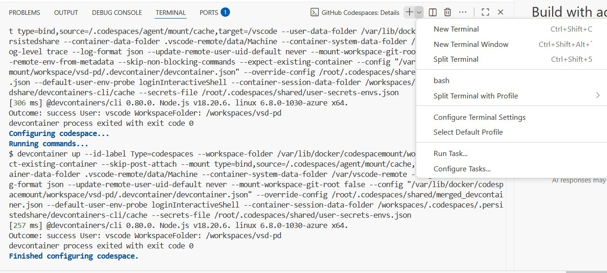

  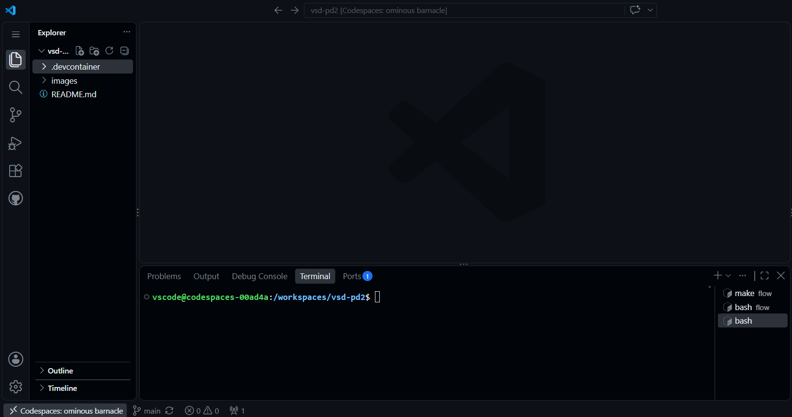

The first thing to check is the tool version, since slack, wire length and DRC counts can change between OpenROAD builds. `openroad -version` reports **v2.0-25794-g7cbd77e748**, and `git log --oneline` shows the ORFS commit.

  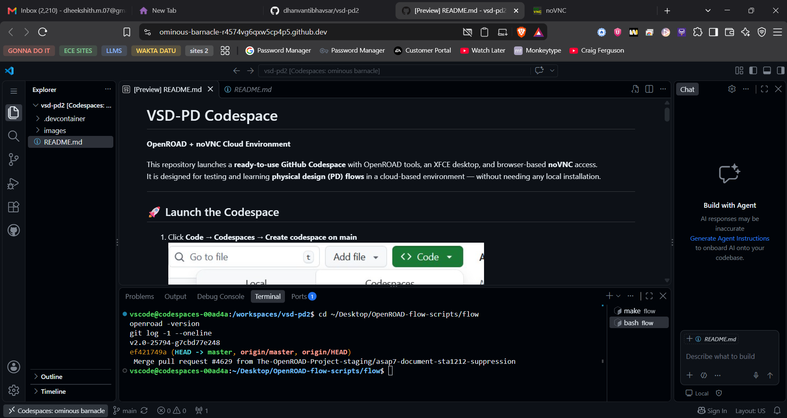

---

## 2. Synthesis

Synthesis converts the RTL into a gate-level netlist using the standard-cell library. The statistics report (`reports/nangate45/gcd/base/synth_stat.txt`) gives the cell counts and area:

- **Chip area** of `\gcd`: **659.946**
- **Sequential area:** 158.27 (**23.98 %**), all from 35 × `DFF_X1`
- **Biggest combinational groups:** 164 × `NAND2_X1`, 86 × `INV_X1`, 60 × `OAI21_X1`

The count and area columns appear twice in the report (before and after mapping) and match, so mapping added no extra cells.

  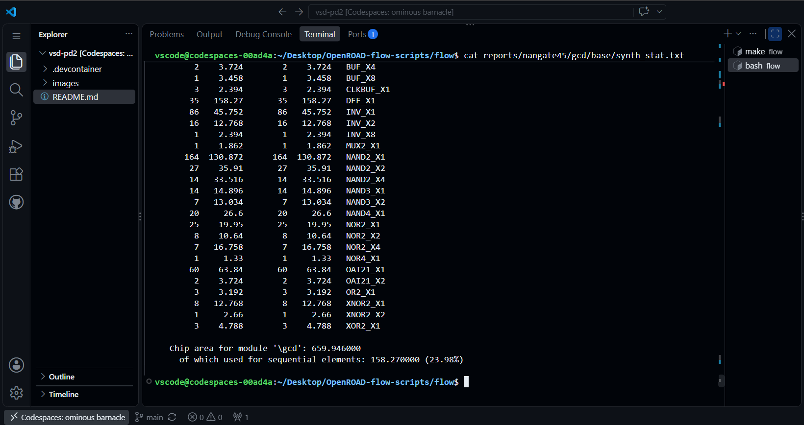

---

## 3. Physical Implementation, Stage by Stage

Each stage writes a numbered `.odb` database and a log, so the design can be inspected after any step. Every stage ends with `report_design_area`, which gives the area and utilization below.

| Stage | Design area (µm²) | Utilization |
|---|---:|---:|
| Floorplan | 708 | 61 % |
| Detailed placement | 850 | 74 % |
| After CTS | 997 | 86 % |
| Global route | 1034 | 90 % |
| Detailed route | 1034 | 90 % |
| Fill-cell insertion | 1034 | 90 % |

Area grows from stage to stage because each step adds cells: tap cells, timing-repair buffers and clock buffers. The design itself does not change.

### Floorplanning

The floorplan defines the die and core area, places macros and tap cells, and builds the power distribution network. The log lists the sub-stages (`2_1_floorplan`, `2_2_floorplan_macro`, `2_3_floorplan_tapcell`, `2_4_floorplan_pdn`). The per-layer via-resistance table printed above the final area is the RC setup that later parasitic estimates use.

  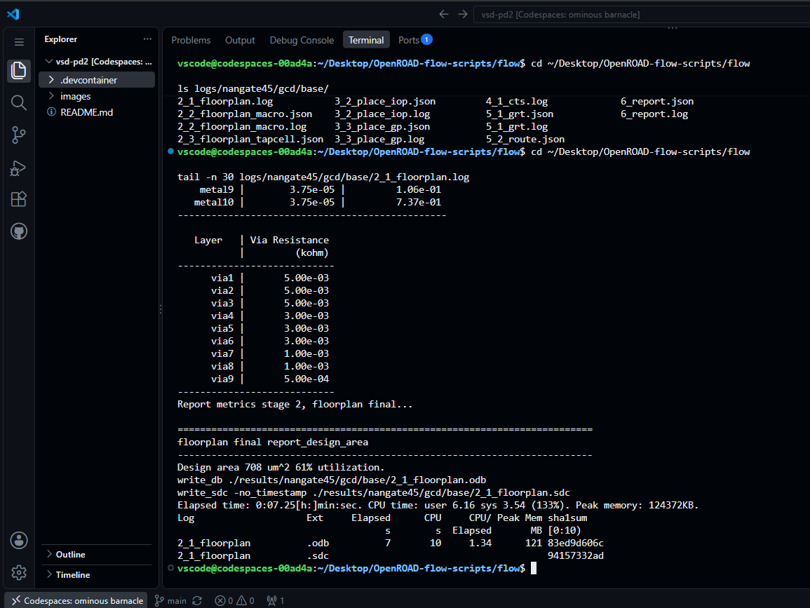

### Placement

Placement positions the standard cells and then legalizes them onto the site grid. The detailed-placement log reports:

- zero cells in no-regions, zero row/site alignment problems, **zero overlaps**
- half-perimeter wirelength (HPWL) improved from **3590.3 µm to 3162.7 µm (−11.9 %)**
- 47 instances mirrored by `optimize_mirroring`

  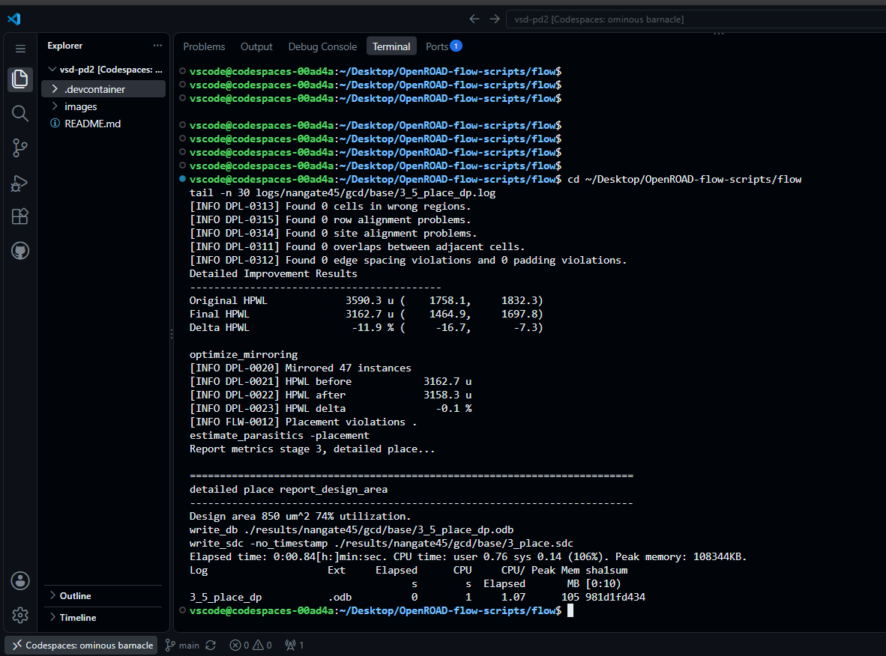

### Clock-Tree Synthesis (CTS)

CTS builds the clock distribution network so the clock reaches all flip-flops with balanced latency and low skew. After CTS the log shows timing repair at work:

- **19 buffers inserted**, 167 instances resized, 34 pins swapped, 1 instance cloned
- a warning that **not all setup violations could be repaired**, while hold reported no violations
- legalization displacement of 819.9 µm total, 10.3 µm maximum

  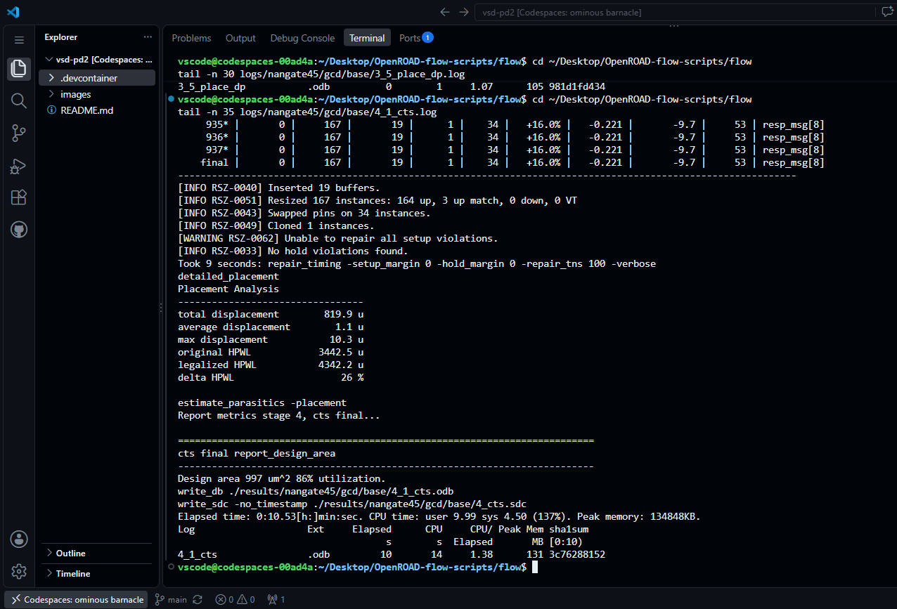

### Global Routing

Global routing plans approximate wire paths through routing regions and checks congestion. The log shows incremental global routing, a congestion report, and the antenna repair step, which found **0 net violations and 0 pin violations**.

  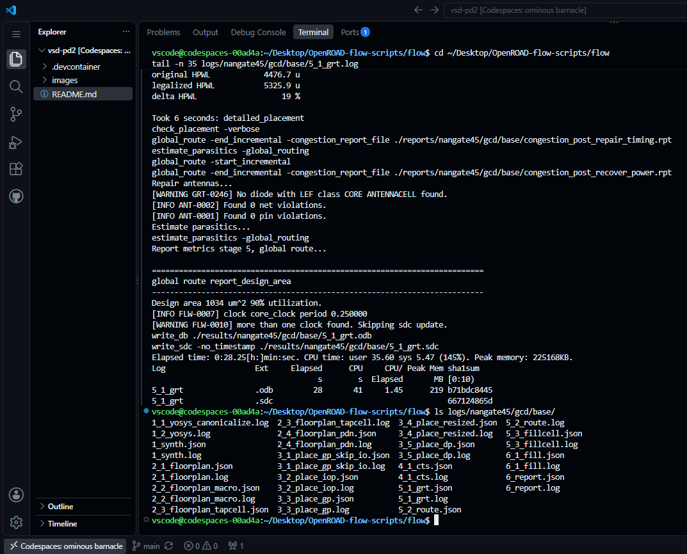

### Detailed Routing

Detailed routing assigns the actual wire geometry on each metal layer and inserts vias. The `5_2_route.log` tail shows:

- **4415 vias** in total: metal1 = 2074, metal2 = 1869, metal3 = 290, metal4 = 135, metal5 = 47 (metal6 and above unused)
- **0 antenna net violations and 0 pin violations**
- `detailed_route` took about 30 s and wrote `5_2_route.odb`

  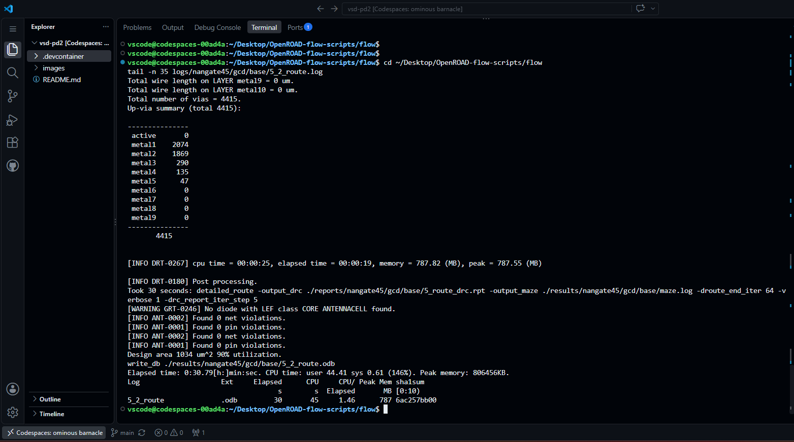

### Metal Fill and Fill Cells

The `6_1_fill` stage reads the routed database and writes `6_1_fill.odb`. Separately, `filler_placement` with `FILLCELL_X1` through `FILLCELL_X32` **placed 178 filler instances**. Filler cells keep the well and implant layers continuous; they add no logic, so the area stays at 1034 µm².

  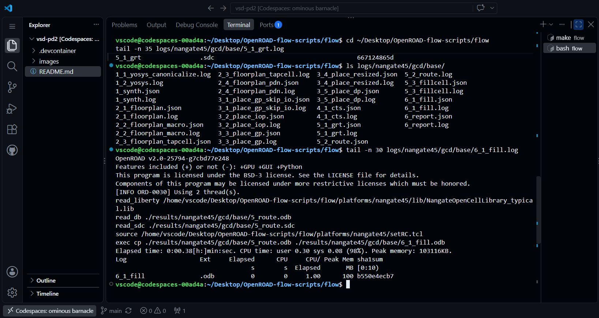

  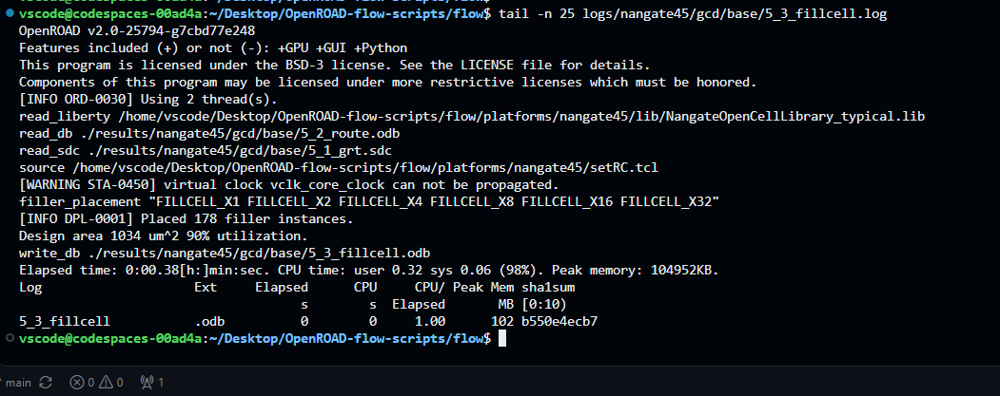

### Global-Route Timing and Power Report

`reports/nangate45/gcd/base/5_global_route.rpt` gives a quick timing and power picture after global routing:

- critical-path delay **0.4358**, critical-path slack **−0.2358** (negative)
- slack ÷ critical-path delay: **−54.107389**
- total power **1.15e-02 W**: sequential 13.3 %, combinational 82.0 %, clock 4.8 %, macro and pad 0 %
- by mechanism: internal 53.1 %, switching 46.6 %, leakage 0.3 %

The negative slack matches the CTS warning above: timing repair did not fully close setup on this run.

  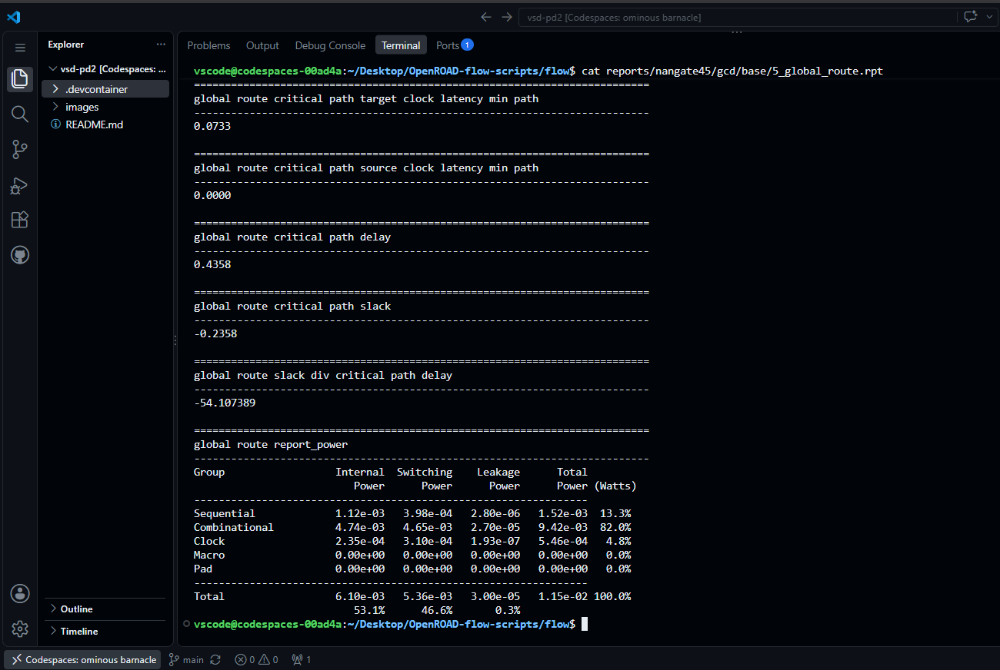

### Database Checkpoints and Final Layout

A `find` over `results/nangate45/gcd/base/` lists every checkpoint, from `1_synth.odb` (637,028 bytes) to `6_final.odb` (**1,382,631 bytes**). The size stays flat across `5_3_fillcell`, `5_route`, `6_1_fill` and `6_final`, since the later stages only add fill. The listing contains `.odb` files only; no `.gds` file appears in it.

  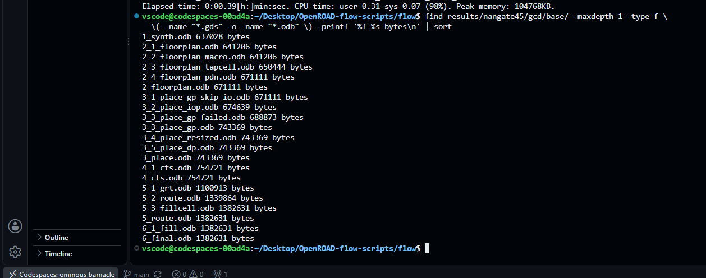

The finished `6_final` database opened in the OpenROAD GUI through noVNC:

  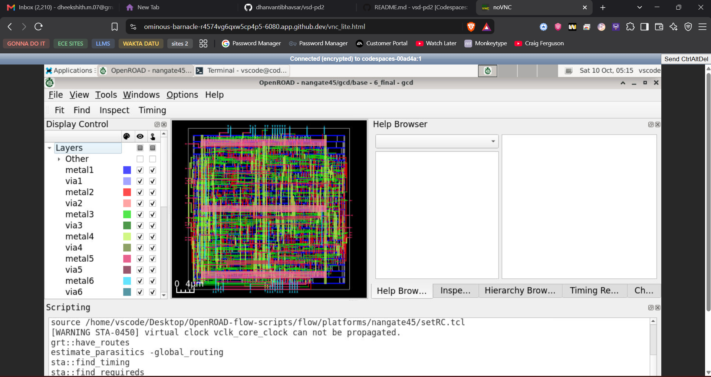

---

## 4. Parasitic Extraction

Post-route STA needs parasitics that match the final route. Instead of reusing older final-stage files, I extracted a fresh SPEF from the latest routed database. Every STA run used:

- **Routed database:** `results/sky130hd/vsdbabysoc/base/5_2_route.odb`
- **Constraints:** `results/sky130hd/vsdbabysoc/base/5_1_grt.sdc`
- **Parasitics:** `results/sky130hd/vsdbabysoc/base/5_2_route_fresh.spef`
- **Standard-cell timing:** one of 16 SKY130HD Liberty corner files per run
- **Macro timing:** `designs/sky130hd/vsdbabysoc/lib/avsddac.lib` and `avsdpll.lib`

---

## 5. Post-Route STA on VSDBABYSOC

### Routed Layout

The routed `vsdbabysoc` design in the OpenROAD GUI. The large pink block labelled `dac` is the DAC macro, with the PLL region at the top. The Scripting pane shows the `read_liberty` commands that load the `avsddac.lib` and `avsdpll.lib` macro models.

  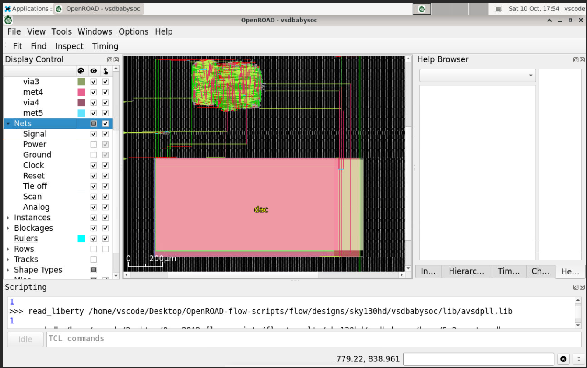

### Typical-Corner Result

At `tt_025C_1v80` with an **11.00 ns** clock period:

- worst setup slack **6.13 ns**
- worst hold slack **0.32 ns**
- setup TNS and hold TNS **0.0 ns**

### Slack Histograms

The endpoint-slack charts for clock `clk` show **30 unconstrained pins** for setup and **26** for hold. Unconstrained pins are not checked by any constraint, so positive slack does not mean every path is covered.

  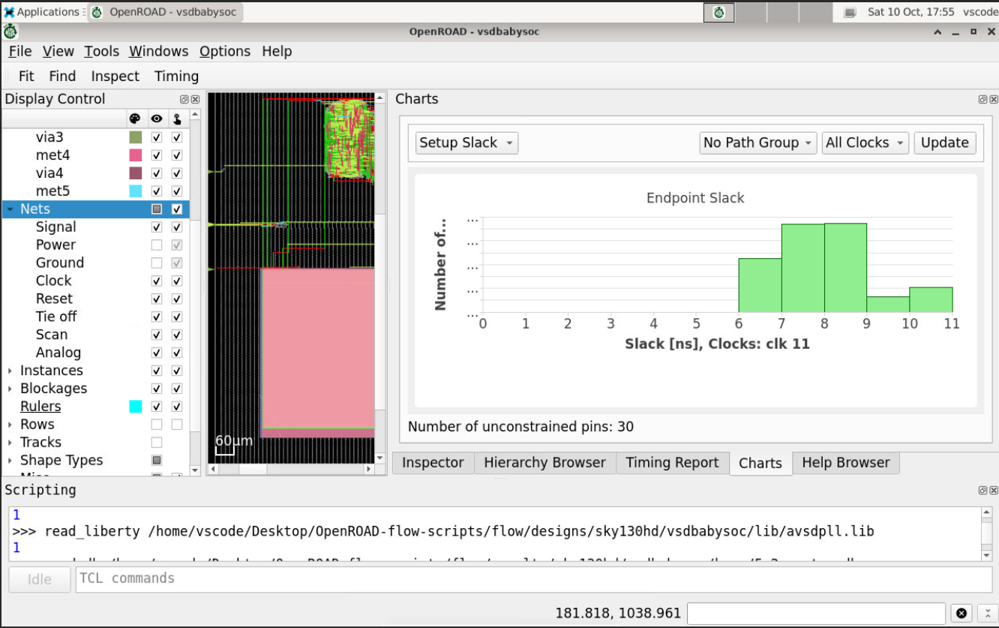

  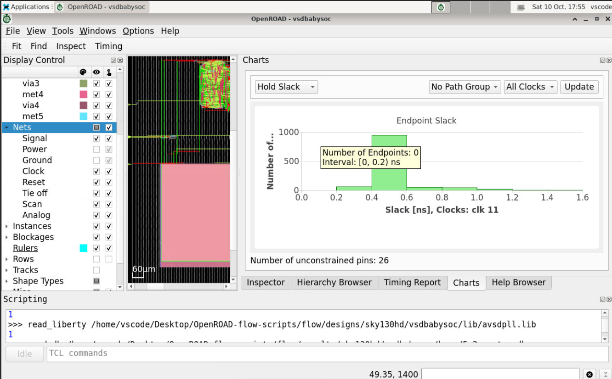

### 16-Corner Experiment

Running STA by hand for every corner would be slow and hard to compare, so I automated it with a Tcl script and a shell loop (`/tmp/run_sta16.sh`). For each corner it reads one standard-cell Liberty file, then the DAC and PLL macro libraries, the routed `.odb`, the `.sdc`, `setRC.tcl` and the `.spef`. It then runs `report_checks` for max and min paths and `report_worst_slack` for max and min, saving a log per corner.

  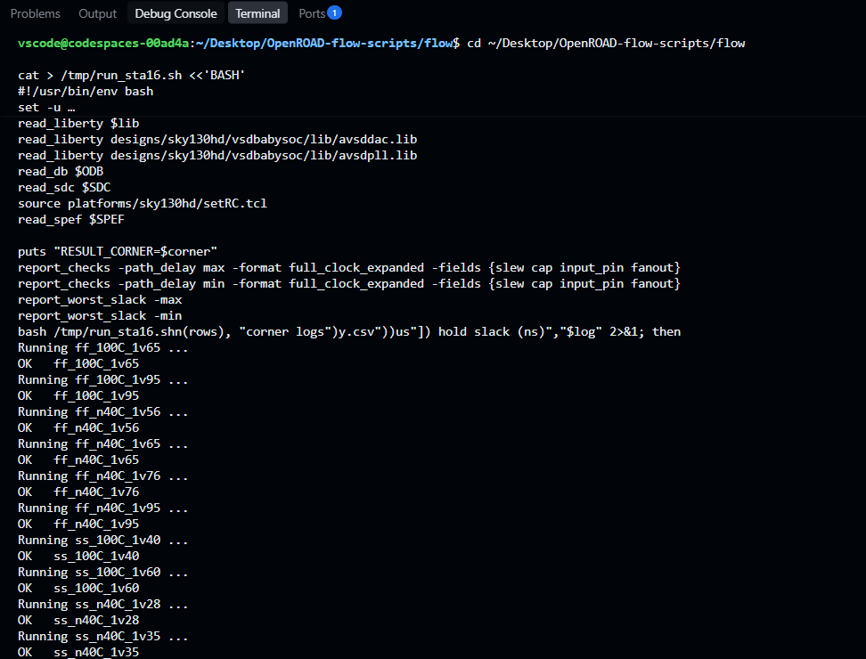

The results are collected in `summary.csv`. It reports `Completed: 32 corner logs`: 16 corners with two log files each, so every corner appears twice with identical values. The status column says `PASS` for every row, which only means the tool run finished.

  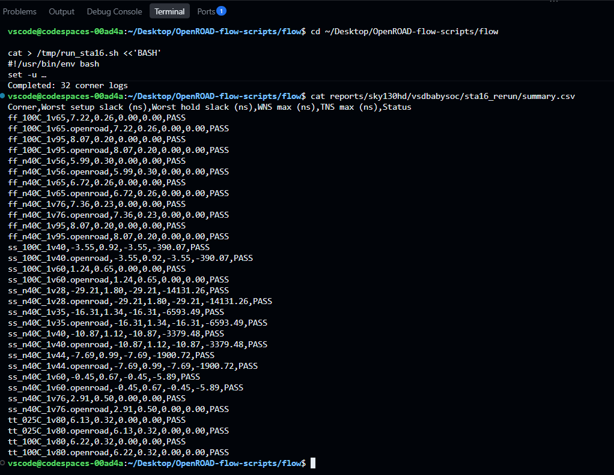

The 16 corners come from the separate SKY130 standard-cell library repository (`skywater-pdk-libs-sky130_fd_sc_hd/timing/`), not from the three-part Liberty files in the VSDBABYSOC repository's own `timing/` folder. The DAC and PLL models stayed at their existing characterization in every run.

| Corner | Setup slack (ns) | Hold slack (ns) | Setup TNS (ns) | Setup result |
|---|---:|---:|---:|---|
| ff_100C_1v65 | 7.22 | 0.26 | 0 | Positive |
| ff_100C_1v95 | 8.07 | 0.20 | 0 | Positive |
| ff_n40C_1v56 | 5.99 | 0.30 | 0 | Positive |
| ff_n40C_1v65 | 6.72 | 0.26 | 0 | Positive |
| ff_n40C_1v76 | 7.36 | 0.23 | 0 | Positive |
| ff_n40C_1v95 | 8.07 | 0.20 | 0 | Positive |
| ss_100C_1v40 | −3.55 | 0.92 | −390.07 | **Negative** |
| ss_100C_1v60 | 1.24 | 0.65 | 0 | Positive |
| ss_n40C_1v28 | −29.21 | 1.80 | −14131.26 | **Negative** |
| ss_n40C_1v35 | −16.31 | 1.34 | −6593.49 | **Negative** |
| ss_n40C_1v40 | −10.87 | 1.12 | −3379.48 | **Negative** |
| ss_n40C_1v44 | −7.69 | 0.99 | −1900.72 | **Negative** |
| ss_n40C_1v60 | −0.45 | 0.67 | −5.89 | **Negative** |
| ss_n40C_1v76 | 2.91 | 0.50 | 0 | Positive |
| tt_025C_1v80 | 6.13 | 0.32 | 0 | Positive |
| tt_100C_1v80 | 6.22 | 0.32 | 0 | Positive |

Values are rounded to two decimals from the recorded output. Hold TNS is 0.0 ns at all 16 corners.

### WNS and TNS by Liberty Corner

These charts plot the **16 unique standard-cell Liberty corners** on the x-axis. The y-axis shows worst setup slack (WNS) in nanoseconds in the first chart and setup total negative slack (TNS) in nanoseconds in the second. Negative values indicate setup-timing violations; zero TNS means no accumulated negative setup slack was reported for that corner.

  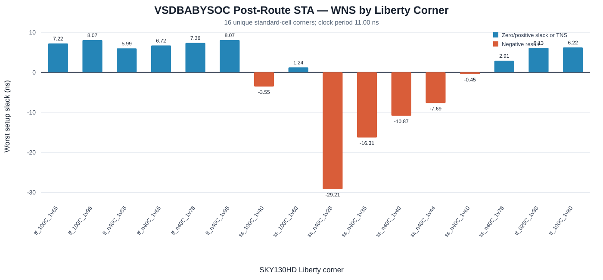

  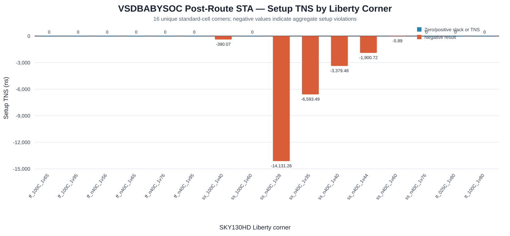

---

## 6. Results and Observations

**Timing across corners**

- All 16 runs completed, but **six corners have negative worst setup slack**: ss_100C_1v40, ss_n40C_1v28, ss_n40C_1v35, ss_n40C_1v40, ss_n40C_1v44 and ss_n40C_1v60.
- The worst case is **−29.21 ns at ss_n40C_1v28**, with setup TNS of −14131.26 ns.
- At the slow-slow, −40 °C corner, setup slack improves steadily as supply voltage rises: −29.21 ns (1.28 V), −16.31 (1.35 V), −10.87 (1.40 V), −7.69 (1.44 V), −0.45 (1.60 V), +2.91 ns (1.76 V). Lower voltage makes the cells slower.
- Hold behaves the opposite way. It is tightest at the fast corners (0.20 ns at ff_100C_1v95 and ff_n40C_1v95) and loosest at slow corners (1.80 ns at ss_n40C_1v28). All hold slacks are positive.

**Routing**

- The recorded VSDBABYSOC detailed-route output reported **28 DRC violations**, all **Metal 1 shorts** around the DAC-related area and nets. No antenna net or pin violations were reported.
- Approximate routed wire length was **227,853 µm**, via count **50,026** and utilization **19 %**.
- Nothing recorded shows the 28 shorts were later removed, so the layout is not DRC-clean.

**Limitations**

- Positive typical-corner slack and the six failing slow corners are separate findings and have to be read together.
- The 30 setup and 26 hold unconstrained pins are not covered by any slack number.
- The macros were not swept across corners, so this is a 16-corner standard-cell sweep, not a full macro-and-cell characterization.

---

## 7. Technical Learnings

1. **The flow is a chain of checkpoints.** Synthesis, floorplan, placement, CTS, routing and fill each write their own database and log, and each answers a different question.
2. **Area and utilization rise through the flow** (61 % → 74 % → 86 % → 90 % for `gcd`) because tap cells, timing-repair buffers and clock buffers are added at each step.
3. **A clean-looking layout is not timing closure.** CTS warned that some setup violations could not be repaired, and the global-route report still shows negative slack.
4. **Post-route STA is only meaningful when the database, SDC, SPEF and Liberty files describe the same run.** That is why a fresh SPEF was extracted.
5. **Setup and hold are stressed at opposite corners.** Setup fails at slow, low-voltage corners; hold is tightest at fast, high-voltage corners. Sign-off needs both ends.
6. **`OK` or `PASS` from a script is a tool status, not a timing result.** Slack and TNS have to be read from the numbers.
7. **Slack does not cover unconstrained pins**, so their count has to be checked alongside WNS and TNS.
8. **Library provenance matters.** The corners came from a separate SKY130 repository and the macros were held fixed, so the scope of the result has to be stated.
9. **A list of `.odb` checkpoints is not a GDS deliverable.** The final-database chain and GDS streaming are separate checks.

---

## 8. Problems Faced and How I Addressed Them

### Environment and flow navigation

Getting the Codespace running and finding the right flow, platform, design and report paths took some digging. I checked the tool version first, moved into the ORFS `flow` directory, and used `ls` and `tail` on `logs/<platform>/<design>/base/` to find each stage's outputs. After that the flow ran end to end and every stage could be inspected.

### Consistency of post-route timing inputs

Older final-stage files could be stale relative to the latest routed database, which would make the layout and the timing disagree. I generated a fresh SPEF (`5_2_route_fresh.spef`) from the latest routed database and used it in every STA run.

### Repeating STA across 16 corners

Manual repetition across corners is slow and error-prone. The Tcl script and shell loop saved a log per corner and collected everything into `summary.csv`, which made the corners directly comparable and exposed the six setup-negative ones.

### Reading "OK" as "timing passed"

Every corner printed `OK` and `PASS`, which is easy to mistake for a timing pass. I read worst setup slack, worst hold slack and TNS for each corner instead of relying on the exit status.

### Duplicate rows in the summary

`summary.csv` reported 32 corner logs with each corner listed twice. The duplicate rows had identical values and came from two log files per corner, so the results are reported as 16 unique corners.

### Routing DRC violations

The VSDBABYSOC detailed-route output contained 28 Metal 1 shorts. Inspecting the route log and DRC report located them around the DAC-area nets. They are documented, but not shown to be fixed.

### Library-set scope

The corner libraries came from a different repository than the three-part Liberty set in the VSDBABYSOC `timing/` folder. I recorded the source of the 16 files and noted that the repository's own Liberty set was not used for the sweep.

---

## 9. Supporting Documents

- [`vsdbabysoc_post_route_sta_report.pdf`](./vsdbabysoc_post_route_sta_report.pdf) – post-route STA report with all 16 corners at full precision, the unconstrained-pin note and the routing caveats
- [`vsdbabysoc_post_route_sta_report.docx`](./vsdbabysoc_post_route_sta_report.docx) – editable version of the same report

---

## 10. Conclusion

This week connected the stages of an RTL-to-layout flow: a stage-by-stage walkthrough on the `nangate45/gcd` reference design, then a post-route multi-corner timing analysis of VSDBABYSOC on SKY130HD.

The flow and all 16 corner runs completed. The analysis also exposed open issues: six corners with negative setup slack (worst −29.21 ns at ss_n40C_1v28), 28 recorded Metal 1 shorts near the DAC, and unconstrained pins that slack numbers do not cover. The main skills gained were validating each checkpoint against its own report, keeping the routed database, constraints, SPEF and Liberty files consistent, automating a corner sweep, and reading the results as they are.
